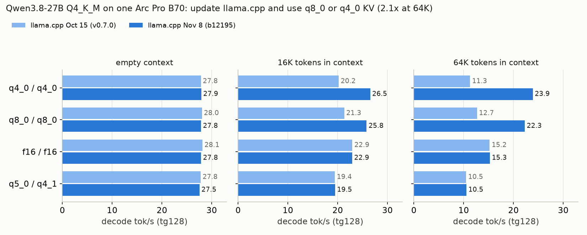

# llama.cpp SYCL on the B70: update, then use q8_0 or q4_0 KV for long context

Measured 2026-11-08 on one Intel Arc Pro B70 (230 W cap), Qwen3.8-27B `Q4_K_M` GGUF,
`llama-bench -ngl 99 -fa 1 -t 8 -p 512 -n 128 -d 0,16384,65536 -r 2`. Status: **screen**
(two repeats per cell). Raw jsonl and the script:
[`results/llamacpp-sycl-kv-depth-20261108/`](../results/llamacpp-sycl-kv-depth-20261108/).

## What to do

1. Build llama.cpp from a tree that includes
   [#31125](https://github.com/ggml-org/llama.cpp/pull/31125) (merged 2026-10-29; we used
   `b12195-3-gf477f795c`).
2. Serve with `-fa on -ctk q8_0 -ctv q8_0` (quality-safe default) or `-ctk q4_0 -ctv q4_0`
   (most context per GB; check your task quality).
3. Stop using `q5_0`/`q4_1` KV if you run long prompts: the new kernel does not cover those
   types, so they stay on the old path.

## Results (decode tok/s, tg128)

| KV (K / V) | empty: Oct 15 → Nov 8 | 16K: Oct 15 → Nov 8 | 64K: Oct 15 → Nov 8 |
|---|---|---|---|
| q4_0 / q4_0 | 27.8 → 27.9 | 20.2 → **26.5 (+31 %)** | 11.3 → **23.9 (+112 %)** |
| q8_0 / q8_0 | 28.0 → 27.8 | 21.3 → **25.8 (+21 %)** | 12.7 → **22.3 (+76 %)** |
| f16 / f16 | 28.1 → 27.8 | 22.9 → 22.9 | 15.2 → 15.3 |
| q5_0 / q4_1 | 27.7 → 27.5 | 19.4 → 19.5 | 10.5 → 10.5 |

- On the new build, quantized q8_0/q4_0 KV is faster than f16 at depth (22–24 vs 15 tok/s
  at 64K) and uses half or a quarter of the memory.
- Prompt processing (pp512) did not change: 315–323 tok/s at empty context, 280–286 at
  64K, for every KV type and both builds.
- One repeat of the Nov 8 f16 empty-context cell read 10.4 tok/s (the other 27.8) during a
  host event on the other card; the table uses the higher repeat for that cell only. All
  other cells' two repeats agree within 1 %.

## Claim boundary

- One model (Qwen3.8-27B, hybrid attention with 16 full-attention layers of 64), one quant
  (`Q4_K_M`), one card, single stream, synthetic `llama-bench` depth (no real prompt
  content). Builds: `v0.7.0` (`620d2225c`, 2026-10-15) vs `b12195-3-gf477f795c`
  (2026-11-08), both `GGML_SYCL=ON`, `GGML_SYCL_GRAPH=ON`, `GGML_SYCL_F16=OFF`, oneAPI 2026.1.
- No output-quality comparison between KV types was run here. q4_0 KV has a documented
  quality cliff on some tasks; q8_0 is the conservative pick.
- Absolute rates are below the TensorFold and EXL3 routes for the same model
  ([TensorFold page](qwen38-27b/TENSORFOLD-B70.md)); this page is about llama.cpp users.
