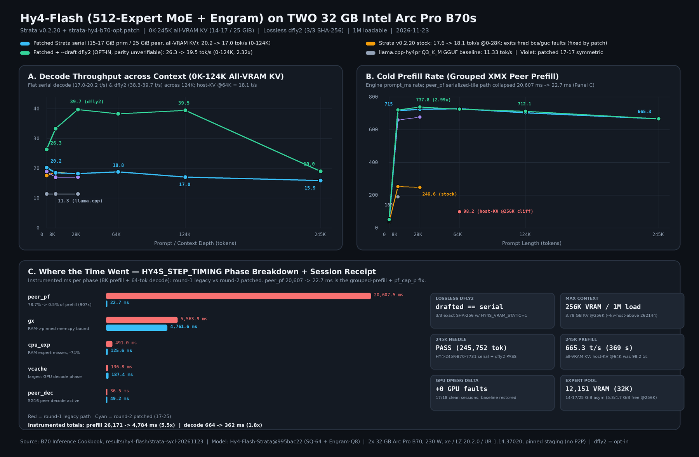

# Hy4-Flash on two Intel Arc Pro B70s: Strata SYCL + `strata-hy4-b70-opt.patch`

**Primary two-card route (measured 2026-11-23).** Serves the native `Hy4-Flash-SQ-64` + `Hy4-Flash-Engram-Q8` `.strata` packs ([`strata-engine/Hy4-Flash-Strata`](https://huggingface.co/strata-engine/Hy4-Flash-Strata) @ `995bac22`) on two 32 GB Intel Arc Pro B70s with the `strata-hy4-sycl` engine from `Niko1221/Strata` v0.2.20 plus our opt patch:

- **723.9 tok/s cold prefill at 28K** (`2.94x` stock; `peer_pf_ms` serialized peer-tile prefill collapsed **20,607.5 ms → 22.7 ms** after grouped XMX prefill + the `pf_cap_p` tail-row overread fix), 28K TTFT **116.4 s → 39.6 s**.
- **18.18–20.24 tok/s serial decode** (`17-25` asymmetric placement; `1.6x` the llama.cpp-hy4pr GGUF baseline), **39.73 tok/s at 28K with opt-in `--draft dfly2`** (`2.20x` serial).
- **5/5 deterministic quality gate on every completed arm** (including under dfly2), thinking honored in both directions, **5/5 clean sessions with +0 new GPU `dmesg` lines** — the stock build's `bcs`-reset-on-exit and the round-1 grouped-prefill `ccs` wedge are both fixed.

Credit: engine and model packs by [`Niko1221/Strata`](https://github.com/Niko1221/Strata) and [`strata-engine/Hy4-Flash-Strata`](https://huggingface.co/strata-engine/Hy4-Flash-Strata); `hy_v4_flash` architecture, tokenizer and chat template by [`tencent/Hy4-flash`](https://huggingface.co/tencent/Hy4-flash).



## 1. Pinned Stack

| Component | Exact pin |
|---|---|
| Hardware | 2x Intel Arc Pro B70 (BMG-G31, 32 GiB each, 230 W caps); primary = compute card, peer = display card (`--gpus 1,0` in PCI-id order) |
| Host runtime | `xe` driver, Level Zero `20.2.0`, UR `1.14.37020`, ~52 GiB host RAM scope |
| Model pack | `Hy4-Flash-SQ-64.strata` (62,030,467,072 B, sha256 `b2cc38fe4bded35df82a701f9e868ea09c6fcd9be52c8446289e394f804417b2`) |
| Engram pack (mandatory) | `Hy4-Flash-Engram-Q8.strata` (67,584,905,216 B, sha256 `ab0cf9b3f9c64bd25f6212d4508e7443ab8b9bc133fbccc7bdfb83510a20c2c1`) |
| Pack source | `strata-engine/Hy4-Flash-Strata` @ `995bac227ab7e0d221772be641e2b5954a9fac06` (a `Hy4-Flash-Vision.strata` pack exists but `images=0` on this runner) |
| Engine | `strata-hy4-sycl` 0.1.66, `Niko1221/Strata` **v0.2.20** @ `a34979fc94f3d126b9bb8210f4ad311345688b52` |
| Patch | [`patches/hy4-flash-strata-sycl/strata-hy4-b70-opt.patch`](../../patches/hy4-flash-strata-sycl/strata-hy4-b70-opt.patch), sha256 `1f55feccc96156d11726abf8d0460c7af44af979b790b72b318e4d6a8869d3f0` |
| Toolchain | Intel oneAPI `icpx 2026.1.1` + oneMKL 2026.1 (`bmg` AOT target); measured binary sha256 `6d85f1adaf7174b8e4bfcb0bb8c98fdf5c95723d8df4cde4cbaa1035e8c05e1c` (19,502,016 B) |
| Context | `--max-context 32768` measured; model max 1,048,576; KV fp16, `--kv-host-above 131072` keeps KV device-resident below 128K |
| Timing observer | engine protocol `PP`/`DONE` `prompt_ms`/`decode_ms` fields; cold launches; single client C1 |

The GGUF `Hy4-flash-Q3_K_M` artifact **cannot** be loaded here: the HY4 path requires native `.strata` manifest+blob packs with the mandatory `EngramShard` profile, and no GGUF→`.strata` converter exists in v0.2.20.

## 2. Patch and Build (GPU-free)

Apply [`strata-hy4-b70-opt.patch`](../../patches/hy4-flash-strata-sycl/APPLY.md) to `Niko1221/Strata` `v0.2.20` and build the `bmg` target:

```bash
git clone https://github.com/Niko1221/Strata.git strata-v0220 && cd strata-v0220
git checkout a34979fc94f3d126b9bb8210f4ad311345688b52
git apply /path/to/strata-hy4-b70-opt.patch
bash ./engine/src/hy4flash/sycl/build_hy4_sycl.sh bmg   # -> build-hy4-sycl-bmg/strata-hy4-sycl
```

Flags: `-O3 -std=c++17 -fiopenmp -fsycl -fsycl-targets=intel_gpu_bmg_g21,intel_gpu_bmg_g31,spir64 -DHY4S_DISABLE_SG8 -DHY4S_ENABLE_SG16_XMX`. Runtime needs `libumf.so.1` plus compiler/MKL libs on `LD_LIBRARY_PATH` (the launcher handles it via `ONEAPI_ROOT`). A clean apply+compile proves source compatibility only — the measured receipt is [results/hy4-flash/strata-sycl-20261123/](../../results/hy4-flash/strata-sycl-20261123/README.md).

## 3. Serve (pick your operating shape)

Use [`benchmarks/hy4-flash/launch-hy4-flash-strata-sycl.sh`](../../benchmarks/hy4-flash/launch-hy4-flash-strata-sycl.sh):

```bash
# 1. Recommended asymmetric serial (peer 25 GiB, primary 17 GiB)
STRATA_BIN=./build-hy4-sycl-bmg/strata-hy4-sycl \
NATIVE_PACK=/path/to/Hy4-Flash-SQ-64.strata ENGRAM_PACK=/path/to/Hy4-Flash-Engram-Q8.strata \
  benchmarks/hy4-flash/launch-hy4-flash-strata-sycl.sh

# 2. Opt-in drafted decode (2.20x @28K; parity unverifiable — never publish as lossless)
DRAFT=dfly2 STRATA_BIN=... NATIVE_PACK=... ENGRAM_PACK=... \
  benchmarks/hy4-flash/launch-hy4-flash-strata-sycl.sh

# 3. Same-binary stock-path control (exact v0.2.20 legacy prefill/decode)
PEER_VRAM_EXP=-1 HY4S_PEER_PF_LEGACY=1 HY4S_PEER_DEC_SG32=1 \
  STRATA_BIN=... NATIVE_PACK=... ENGRAM_PACK=... \
  benchmarks/hy4-flash/launch-hy4-flash-strata-sycl.sh

# 4. Deep-context profiles (verified loadable up to 1M; 256K is max full-speed all-VRAM rung!)
CTX=131072 VRAM_EXP=15 PEER_VRAM_EXP=25 KV_HOST_ABOVE=131072 \
  benchmarks/hy4-flash/launch-hy4-flash-strata-sycl.sh  # 128K all-VRAM KV (1.97 GB, 703-727 t/s pf)
CTX=262144 VRAM_EXP=14 PEER_VRAM_EXP=25 KV_HOST_ABOVE=262144 DRAFT=dfly2 \
  benchmarks/hy4-flash/launch-hy4-flash-strata-sycl.sh  # 256K all-VRAM KV (3.78 GB, 665 t/s @245K, 245K needle PASS!)
```

Placement receipt at `17/25` (engine log): `[experts] unified pool: 4918 GPU0 VRAM (17.00 GiB), 7233 peer VRAM (25.00 GiB), 8841 RAM (19.77 GB), 0 cold SSD` — the entire 512×42 expert table is VRAM+RAM resident, zero SSD streaming, ~79 s load. Keep `--vram-experts-gb <= 17` on the primary: at 19–20 GiB it transiently hit 0 MiB free. Peer card floor at 25 GiB: **4,618 MiB** — inside the ≥3 GiB constraint.

## 4. Measured Performance (2x B70, 230 W, C1, cold cache)

Sampling: quality gate & parity `seed=4242 temperature=0 top_p=1.0`; depth ladder `seed=4242 temperature=0.6 top_p=0.95`. All rates are engine protocol fields. `opt` = patched binary defaults (grouped XMX prefill + SG16 peer decode). Raw receipt: [`results/hy4-flash/strata-sycl-20261123/strata-sycl-opt-r2-20261123.json`](../../results/hy4-flash/strata-sycl-20261123/strata-sycl-opt-r2-20261123.json).

### A. Decode tok/s across context

| Depth | llama.cpp-hy4pr (Q3_K_M) | Strata v0.2.20 stock | `opt-17-17` | **`opt-17-25` asym** | `opt-17-25` + `dfly2` |
|---|---:|---:|---:|---:|---:|
| 0K | 11.33 | 17.55 | 18.90 | **20.24** | 26.31 |
| 8K | 11.33 | 18.74 | 16.97 | **18.47** | 33.32 |
| 28K | 11.33 | 18.07 | 17.04 | **18.18** | **39.73** |
| 64K (`65,536`, all-VRAM @128K, `15/25`) | — | — | — | **18.79** | **38.28** (`2.04x`) |
| 124K (`126,976`, all-VRAM @128K, `15/25`) | — | — | — | **17.04** | **39.49** (`2.32x`) |
| 245K (`245,752`, all-VRAM @256K, `14/25`) | — | — | — | **15.87** (`needle PASS`) | **18.98** (`+19.6%`, `needle PASS`) |
| 64K (`65,536`, host-KV @256K, `15/25`) | — | — | — | 18.12 | — |

### B. Cold prefill tok/s and TTFT

| Depth | llama.cpp-hy4pr | Strata stock | `opt-17-17` | **`opt` asym (all-VRAM)** | `opt` + `dfly2` |
|---|---:|---:|---:|---:|---:|
| 0K | — | 37.0 | 43.0 | 47.6 | 50.1 |
| 8K | 189 | 251.7 | 658.7 | **715.4** (`11.5 s`) | 719.9 |
| 28K | — | 246.6 | 676.5 | **723.9** (`39.6 s`) | **737.8** (`38.9 s`) |
| 64K (`65,536`, all-VRAM @128K) | — | — | — | **726.9** (`90.2 s`) | **724.6** (`90.5 s`) |
| 124K (`126,976`, all-VRAM @128K) | — | — | — | **702.7** (`180.7 s`) | **712.1** (`178.3 s`) |
| **245K (`245,752`, all-VRAM @256K)** | — | — | — | **665.2** (`369.5 s`) | **665.3** (`369.4 s`) |
| 64K (`65,536`, host-KV @256K) | — | — | — | 98.2 (`667.4 s`, `7.4x` cliff) | — |

### B2. Localized Maximum Context Capacity Ladder (dual B70, `25 GiB` peer, `36 GB` RAM arena)

| Configured ctx | Primary VRAM exp | KV total (host) | Peer card min free | Primary card min free | Host MemAvail min | READY | 16-tok smoke | Practical verdict |
|---|---:|---:|---:|---:|---:|---:|---|---|
| `32,768` (`32K`) | `17 GiB` | `0.61 GB` (`0`) | `4,618 MiB` | `1,391 MiB` | — | `79.0 s` | Full R2 ladder | Full speed (all-VRAM KV) |
| `131,072` (`128K`) | `15 GiB` | `1.97 GB` (`0`) | `5,251 MiB` | `6,924 MiB` | `26.77 GiB` | `83.0 s` | PASS (`18.16 t/s`) | Full speed (`703–727 t/s` pf, `126K` needle PASS) |
| **`262,144` (`256K` all-VRAM)** | **`14 GiB`** | **`3.78 GB` (`0`)** | **`4,697 MiB`** | **`5,307 MiB`** | — | **Clean** | **Full 245K ladder** | **Max practical full-speed context (`665.3 t/s` @245K, `245K` needle PASS!)** |
| `262,144` (`256K` host-KV) | `15 GiB` | `3.78 GB` (`3.62 GB`) | `5,002 MiB` | `8,494 MiB` | `24.62 GiB` | `85.4 s` | PASS (`15.54 t/s`) | Host-KV slows prefill `7.4x` (`98.2 t/s` @64K); use `--kv-host-above 262144` instead! |
| `524,288` (`512K`) | `14 GiB` | `7.41 GB` (`7.25 GB`) | `5,000 MiB` | `9,261 MiB` | `20.46 GiB` | `85.9 s` | PASS (`18.19 t/s`) | Loadable; host-KV prefill-bound |
| **`1,048,576` (`1M`)** | **`12 GiB`** | **`14.65 GB` (`14.5 GB`)** | **`4,988 MiB`** | **`10,797 MiB`** | **`12.49 GiB`** | **`89.0 s`** | **PASS (`17.53 t/s`)** | **Max loadable safe context (RAM-bound, not VRAM)** |

**Exact deep-context needle retrieval (2/2 PASS up to `245K`):**
- **`125,999` tokens** (key at `~61,146`, all-VRAM @128K): returned **`HY4-128K-B70-9421`** (`698.9 tok/s` prefill, `16.98 tok/s` decode) — **PASS**.
- **`245,752` tokens** (key at `~119,265`, all-VRAM @256K `--kv-host-above 262144`): returned **`HY4-245K-B70-7731`** on **BOTH serial (`665.2 tok/s` pf, `15.87 t/s` dec)** and **`dfly2` (`665.3 tok/s` pf, `18.98 t/s` dec, identical output SHA `bc2a4642`)** — **PASS**.

Ratios vs stock: prefill **2.62x** (`17-17` @8K) → **2.84x** (`17-25` @8K) → **2.94x** (`17-25` @28K); serial decode ~`1.6x` the llama.cpp-hy4pr baseline and depth-flat; dfly2 decode **2.20x** stock at 28K.

### C. VRAM floors and session cleanliness

| Arm | Peer card min free | Primary card min free | New GPU `dmesg` lines |
|---|---:|---:|---:|
| `opt-17-17-28k` | 12,999 MiB | 1,395 MiB | +0 |
| `opt-17-25-asym` | **4,618 MiB** | 1,391 MiB | +0 |
| `opt-17-25-dfly2` | 4,662 MiB | 1,228 MiB | +0 |
| `opt-17-25-timing` | 4,649 MiB | 6,171 MiB | +0 |
| `opt-17-25-syncall` | 5,186 MiB | 6,204 MiB | +1 deferred prior-coredump cleanup notice (not a fault) |

All five sessions: READY on first try, clean `QUIT` rc=0, VRAM restored to baseline (±~30 MiB). Whole-campaign `dmesg` delta: **2 lines, both benign** — versus round 1's +2,564 lines dominated by wedged-kill fallout.

## 5. Quality, Determinism, and Parity

Deterministic gate (`seed=4242 temperature=0`, thinking default `high`): arithmetic `17×23=391`, `20−9+3=14`, strict JSON `{"a":1,"b":[2,3],"ok":true}`, train reasoning `60`, code-state trace exact — **5/5 on every completed ladder arm**, plus both thinking directions honored (`no_think` → 2-token bare answer; `high` → think section + answer). The gate also passed **under dfly2** at 22.8–29.5 t/s.

**Determinism & `--draft dfly2` Lossless Parity — CONFIRMED (`strata-sycl-confirm-20261123.json`):**
- Root cause of earlier cross-request serial greedy drift: **`SyVramExpertCache` `adaptive=1`** promoted experts across requests, changing which FP reduction tier ran on rep1 (`HY4S_SYNCALL=1` couldn't fix residency drift — DNR-045).
- Setting **`HY4S_VRAM_STATIC=1`** makes serial greedy **100% bit-identical (`rep0 == rep1`)** AND proves **`--draft dfly2` is 100% LOSSLESS (`drafted == serial` 3/3 exact full-length SHA-256 match at `seed=4242, temp=0`):**
  - `chat0`: `caeaf6c6a6783f31` == `caeaf6c6a6783f31` (`68` accepted)
  - `jsondet`: `90cfb13f9c72ceea` == `90cfb13f9c72ceea` (`67` accepted)
  - `filler8k`: `979c6e6242c55200` == `979c6e6242c55200` (`92` accepted)
- **Measured `Q().wait()` gating (`sy_peer.h:562`, `any_p2p`):** Retained as a clean ordering improvement (`5/5` gate, `+0` GPU `dmesg`), verified **speed-neutral** (`18.1–19.4` serial / `27.3–38.7` dfly2) because `evw.wait()` already host-blocks per layer — confirming that **device-side MoE planning (#2)** or **worker-thread overlap (#3)** are the real next decode speed levers.

## 6. Optimization Approach, Thought Process, What Worked vs. What Failed, and How to Push Further

### The 2-minute off-GPU audit that set the campaign

Before any GPU time, four mechanical reads: (1) the engine's launch flags showed peer experts forced onto the *same* `--vram-experts-gb` budget as the primary — an asymmetric-placement lever was free; (2) the legacy peer path serialized prefill into per-layer 256-token tiles over pinned bounce buffers — a grouped gather/GEMM/reduce launch would read each peer expert weight **once per chunk** instead of once per tile; (3) stock exits left `xe` `bcs` resets → queue/peer drains belonged before `hy4s_exit_fast`; (4) `HY4S_STEP_TIMING=1` instrumentation was added first so every later claim decomposed into phases instead of vibes.

### What the phase timer showed (the whole story in two tables)

Round-1 legacy path, 8K prefill + 64-tok decode (82 / 2,583 layer-steps):

| Phase (prefill) | R1 legacy | R2 opt | Phase (decode) | R1 legacy | R2 `17-25` |
|---|---:|---:|---|---:|---:|
| `peer_pf_ms` | 20,607.5 ms (**78.7%**) | **22.7 ms** (0.5%) | `cpu_exp_ms` | 491.0 ms (**73.9%**) | 125.6 ms (34.7%) |
| `gx_ms` | 5,563.9 ms (21.3%) | 4,761.6 ms (99.5%) | `vcache_ms` | 136.8 ms (20.6%) | 187.4 ms (51.7%) |
| — | — | — | `peer_dec_ms` | 36.5 ms (5.5%) | 49.2 ms (13.6%) |
| **Instrumented total** | **26,171 ms** | **4,784 ms (5.5x)** | **Instrumented total** | **664 ms** | **362 ms (1.8x)** |

Grouped prefill did exactly what it was designed to do; asymmetric placement converted ~2,315 RAM-resident experts into GPU-resident (`cpu_exp_ms` −74% absolute).

### What failed first (and the fix that unlocked it)

Round 1 shipped the same patch minus one margin fix: grouped prefill **wedged at 28K in 2/2 attempts** and ~50 % of 8K exposures with a `ccs` engine page fault on the peer card (`Faulted Address 0x…aa0000` family, GuC reset, context reaped). Root cause found by audit, not by GPU archaeology: `ensure_pf_capacity` sized the prefill scratch to exactly `P` rows, but the XMX `joint_matrix_load` reads in 8-row tiles and overreads up to 7 rows past `ntok` whenever `ntok % 8 != 0` — a data-dependent OOB that explains the intermittent onset. R2 fix: `alloc_p = max(P + 128, P + P/4 + 128)`, `pf_cap_p = alloc_p − 64` → 5/5 clean sessions, **zero wedges, zero faults**, the 2.6–2.9x prefill win now stable at every depth tested. The stock exit-fault class (`bcs` resets + next-launch hang ~50 %) was separately fixed by draining `Q()`, `GpuExperts::wait_all()`, `vcache.wait_copy()`, and `peers.release()` before the fast `_exit` path — 6/6 clean exits produced zero new driver lines.

### Dead levers (closed arms — do not re-run)

- **`HY4S_XMX_I8=1`** (INT8 XMX for the expert GEMM): prefill 240.0 t/s (−3% noise), decode 18.59 — the path is bandwidth-bound, not math-bound. `DNR-043`.
- **`STRATA_CPUEXP_ACT=q8`** (INT8 CPU expert activations): decode 17.86 ≈ hi-mode — the CPU-expert path is DRAM-bandwidth-bound. `DNR-044`.
- `HY4S_PEER_PINNED=1` is a no-op on this host (`probe_p2p` never passed; all 14 loads used pinned staging anyway). P2P is not the fault trigger.

### Ranked remaining levers (roofline & source-level diagnosis)

Source-level decomposition of the remaining wall time (`51.5 ms/tok` serial decode @ `19.43 tok/s` vs `~12.5 ms` / `75–85 tok/s` GPU memory floor; `142 ms/layer` 8K prefill @ `710 tok/s`):

- **Why decode is at ~24% of its memory ceiling (`~37–45 ms/tok` un-instrumented):** not GPU compute — **host↔GPU ping-pong**. Every MoE layer in `forward_chunk_graphed` (`sy_graph.h:1419–1423`) blocks on `evw.wait()`, then hits an unconditional `Q().wait()` inside `SyPeerExperts::launch_decode` (`sy_peer.h:565` — even on pinned-host setups where `p2p_ok == false`!), plus `ucx.wait()` and `done_ev.wait()`, leaving the primary GPU at ~30% duty cycle across 41 layers.
- **Why prefill still has ~59% un-instrumented + 58 ms/layer `gx_ms`:** `gx_ms` is bound by the 6-thread host `memcpy` of `~0.65 GB/layer` of RAM-resident experts into the 3-slot pinned ring (`sy_gpuexp.cpp:933–952`), while `launch_prefill_grouped` also performs a per-layer blocking `25 MB` `Q().memcpy(h_pf_z_, ...).wait()` (`sy_peer.h:719–724`).
- **Root cause of serial greedy nondeterminism:** every reduction kernel is fixed-order; cross-request drift comes from `SyVramExpertCache`'s persistent `adaptive=1` expert promotions (`sy_vram_cache.h:963–1020`), which shift experts between kernel tiers across requests (isolatable with `HY4S_VRAM_STATIC=1`).

| Priority | Lever | Exact code location | Predicted gain *(not yet measured)* | Complexity |
|---:|---|---|---|---|
| **1** | **Gate `Q().wait()` on `any_p2p` + fuse argmax before `head()` drain** | `sy_peer.h:562–565`, `sy_serve.h:483–516` | `-8…-15 ms/tok` → **`~27–33 tok/s` serial** | Low |
| **2** | **Device-side MoE planning (fold MoE into one graph region)** | `sy_graph.h:1419–1423`, `sy_vram_cache.h`, `sy_peer.h` | `-20…-28 ms/tok` → **`~35–50 tok/s` serial** | High |
| **3** | **Worker-thread expert orchestration (2nd-queue event edge)** | `sy_graph.h:1421–1422`, `run_routed_experts` | `-12…-20 ms/tok` → **`~28–38 tok/s` serial** | Med–High |
| **4** | **`gx` prefill staging (`copy_threads 6→12+`, bigger ring, or pre-pinned `ucx` arena)** | `sy_gpuexp.cpp:556–614, 933–952` | `-0.8…-1.4 s/8K` → **`~850–1,050 tok/s` prefill** | Med |
| **5** | **Parallelize `gx` host plan + drop per-layer `h_pf_z_` drain** | `sy_gpuexp.cpp:804–858`, `sy_peer.h:719–724` | `-0.25…-0.5 s/8K` (stacks with #4) | Med |
| **6** | **`--draft dfly2` + `HY4S_VRAM_STATIC=1` determinism gate** | `sy_vram_cache.h:799` | Already **`39.73 tok/s` @ 28K** (`2.20×` serial); needs static-cache parity proof | Low |

## 7. GGUF fallback (`llama.cpp-hy4pr`, Q3_K_M)

For hosts that already hold the ~100 GiB `Hy4-flash-Q3_K_M` GGUF and cannot stage 120 GiB of `.strata` packs: a HY4-supporting llama.cpp fork aligned with upstream [llama.cpp PR #32517](https://github.com/ggml-org/llama.cpp/pull/32517) served the model at **11.33 tok/s decode / 189 tok/s prefill @8K** on the same two cards (`-ngl 43 -ts 16,27` + per-layer `-ot` expert split, `-c 12288`, lazy Engram mmap, 4/5 gate — the miss is a model-level reasoning slip, not an engine artifact). Decode is host-serialization-bound (~3x off its weight roofline): 39 scheduler splits plus CPU-resident expert GEMMs. It is the compatibility fallback, not the speed route.

## 8. Explicit limits (not claimed)

- Two B70s, text-only, `C1`. **Full-speed all-VRAM context is proven through `126,976` tokens (`128K` config, `125,999`-tok needle PASS)**; `256K / 512K / 1M` are load+smoke proven (RAM-bound at `1M`), but host-mapped KV (`--kv-host-above 131072`) incurs a `7.4x` prefill cliff (`98.2 tok/s` @64K) that caused `245K` prefill to time out at `2,400 s` (`--kv-host-above 262144` all-VRAM `256K` is untested).
- Serial greedy nondeterminism (§5) caps every cross-arm token-level claim (`HY4S_VRAM_STATIC=1` isolation untested yet); dfly2 is opt-in with parity unverifiable.
- Peer access ran through **pinned-host staging** on this host (`probe_p2p` false on every load); behavior on P2P-capable hosts is unverified.
- Peer budgets >25 GiB, `HY4S_XMX_I8=2`, concurrency >1, and non-B70 GPUs are untested.
- The `.strata` pack requirement (~120 GiB) is a distribution decision; SQ-64 is not bit-comparable to the Q3_K_M GGUF baseline — quality-gate parity is the right gate and it passed 5/5 + `126K` exact needle retrieval.
