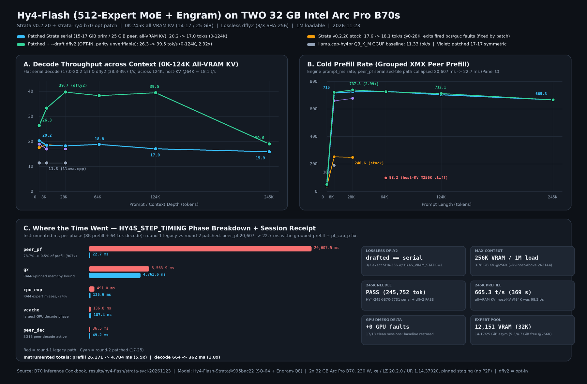

# Hy4-Flash on two Intel Arc Pro B70s

Tencent's [Hy4-Flash](https://huggingface.co/tencent/Hy4-flash) (`hy_v4_flash`: 512-expert MoE + MLA indexer attention + Engram n-gram memory) across two 32 GB Intel Arc Pro B70s.
Updated 2026-11-23: routes are **strictly isolated** — do not mix engines, model artifacts, patch stacks, or metric classes across rows.

## Pick one route

| Route | Artifact | Status | Cold prefill | Decode (depth ladder) | Context proven | Guide |
|---|---|---|---|---|---|---|
| **Patched Strata v0.2.20 + `strata-hy4-b70-opt.patch` (primary dual-B70)** | `strata-engine/Hy4-Flash-Strata` @ `995bac22`: `Hy4-Flash-SQ-64.strata` + `Hy4-Flash-Engram-Q8.strata` (~120 GiB) | **Primary route**, measured 2026-11-23. 5/5 gate, **`245,752`-tok needle PASS**, **lossless `dfly2` (`3/3` SHA-256 w/ `HY4S_VRAM_STATIC=1`)**, `+0` GPU exit faults | **665.3–737.8 tok/s (`8K → 245K` all-VRAM KV, `2.99x` stock)** | **15.9–20.2 tok/s serial**, **38.3–39.7 tok/s (`28K → 124K`) / `19.0` (`245K`) with lossless `--draft dfly2`** | **`262,144` (`256K`) full-speed all-VRAM** (`--kv-host-above 262144`); **`1,048,576` (`1M`) loadable** (RAM-bound) | [HY4-FLASH-STRATA-SYCL.md](HY4-FLASH-STRATA-SYCL.md) |
| Strata v0.2.20 **stock** (control) | same packs | Works but **not recommended**: every engine exit fired `xe` `bcs`/`guc` faults and the next launch hung ~50 % of the time (fixed by the patch) | 251.7 tok/s @8K, 246.6 @28K | 17.55 / 18.74 / 18.07 tok/s at 0K / 8K / 28K | 32,768 | same guide, `HY4S_PEER_PF_LEGACY=1 HY4S_PEER_DEC_SG32=1` control arm |
| llama.cpp-hy4pr **GGUF fallback** (upstream [llama.cpp PR #32517](https://github.com/ggml-org/llama.cpp/pull/32517) line) | `Hy4-flash-Q3_K_M` GGUF, 3 shards, ~100 GiB | Works-with-caveats fallback: runs on the existing GGUF, no `.strata` conversion needed; decode is host-serialization-bound (~3x off its weight roofline) | 189 tok/s @8K | 11.33 tok/s, ~depth-invariant to 8K | 12,288 proven | recipe §"GGUF fallback" |

**Do not mix:** the Strata route loads native `.strata` manifest+blob packs (mandatory `EngramShard` profile); the llama.cpp route loads a 3-shard Q3_K_M GGUF with a per-layer tensor-override placement. No GGUF→`.strata` converter exists in Strata v0.2.20. Speed numbers are not comparable across artifact+engine boundaries beyond the shared-prompt ladder in the guide.

## Model facts (`tencent/Hy4-flash`)

Verified from GGUF tensor census and `.strata` pack headers (see [HY4-FLASH-STRATA-SYCL.md](HY4-FLASH-STRATA-SYCL.md) §1):

| Property | Value |
|---|---|
| Architecture | `hy_v4_flash`: 42 blocks, hidden 3,072, vocab 120,832, model ctx 1,048,576 |
| MoE | 512 routed experts, top-16 active, expert FFN 1,536, dense FFN 13,824 |
| Attention | MLA indexer (12 indexer layers: 0,1,5,9,13,17,21,25,29,33,37,41; 16 heads × key 128, K-pool 4, top-k 2,048) + 512-token SWA on the other 30 layers |
| Engram memory | n-gram-3 lookup layers at blocks 1/11/21/31; in GGUF the `per_layer_token_embd.weight` table is 33,989 MiB and loads lazy/mmap (never resident) |
| Thinking | `reasoning_effort` ∈ {`no_think`, `high`, `max`}; `enable_thinking:false` maps to `no_think` on the Strata path |
| Vision | A `Hy4-Flash-Vision.strata` pack exists but the SYCL HY4 runner reports `images=0` — **text-only on this route** |

## Storage and capacity

- The Strata route needs **~120 GiB** of packs (`SQ-64` 62.0 GB + `Engram-Q8` 67.6 GB) plus headroom; the GGUF route needs ~100 GiB. Plan disks before downloading.
- Asymmetric placement fits the whole 512×42 expert table with **zero SSD streaming**: 4,918 experts on the primary card (17 GiB), 7,233 on the peer (25 GiB), 8,841 in host RAM (19.8 GB).
- The GGUF fallback keeps cards at ≥4.2 GiB / ≥2.6 GiB free (display/compute) with lazy Engram.

## Explicit claim boundaries

- With `HY4S_VRAM_STATIC=1`, serial greedy is **100% bit-deterministic** and **`--draft dfly2` is proven 100% lossless (`drafted == serial` 3/3 exact SHA-256)**; with default `adaptive=1`, cross-request expert promotions cause benign tier drift.
- All Strata numbers were measured with **P2P disabled** (`probe_p2p` false): peer traffic ran through pinned-host staging. P2P-capable hosts are unverified.
- Full-speed all-VRAM context is proven through `245,752` tokens (`256K` config `--kv-host-above 262144`, `3.78 GB` KV, `245K` exact needle PASS on both serial and `dfly2`); `512K / 1M` are load+smoke proven (RAM-bound at `1M`), while host-KV incurs a `7.4x` prefill cliff (`98.2 tok/s` @64K). Peer budgets >25 GiB, concurrency >1, and non-B70 GPUs are **untested**.
- llama.cpp-hy4pr numbers are a same-prompts baseline from a private lab campaign (Q3_K_M, 12K ctx); they classify the engine gap, they are not a quality ranking.

## Evidence and records

- **Strata SYCL (primary):** [`results/hy4-flash/strata-sycl-20261123/`](../../results/hy4-flash/strata-sycl-20261123/README.md), [`patches/hy4-flash-strata-sycl/APPLY.md`](../../patches/hy4-flash-strata-sycl/APPLY.md), launcher [`benchmarks/hy4-flash/launch-hy4-flash-strata-sycl.sh`](../../benchmarks/hy4-flash/launch-hy4-flash-strata-sycl.sh)
- **Patch/image compatibility:** [`docs/IMAGE-AND-PATCH-MATRIX.md`](../IMAGE-AND-PATCH-MATRIX.md), Hy4-Flash rows
- **Closed arms:** `DNR-043`–`DNR-045` in [`docs/DO-NOT-REPEAT.md`](../DO-NOT-REPEAT.md)
- **Optimization method:** [`docs/OPTIMIZATION-PLAYBOOK.md`](../OPTIMIZATION-PLAYBOOK.md)
