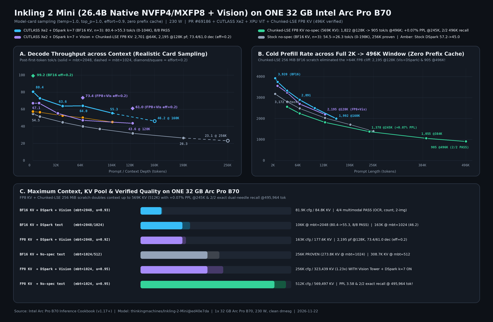
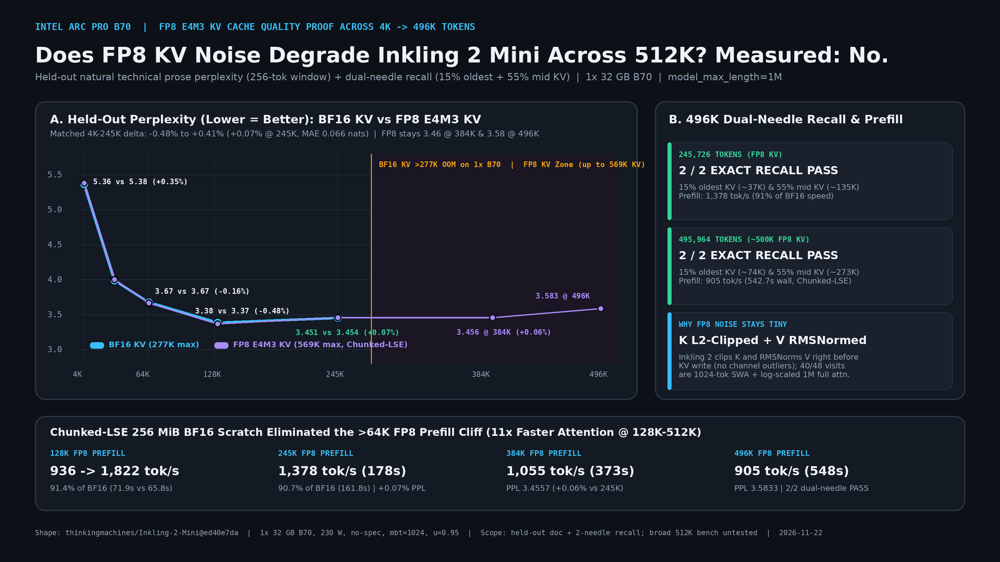

# Inkling 2 Mini on Intel Arc Pro B70: vLLM XPU + `vllm-inkling2-xpu` + Opt-in CUTLASS Xe2

**Primary one-card route (measured 2026-11-22).** Serves the unmodified [`thinkingmachines/Inkling-2-Mini`](https://huggingface.co/thinkingmachines/Inkling-2-Mini) checkpoint (native NVFP4/MXFP8 routed experts, BF16 dense/attention/`lm_head`, BF16 KV cache) on a single 32 GB Intel Arc Pro B70 across two complementary single-card operating profiles:

- **Speed-first interactive profile (`INK2_CUTLASS_MOE=1` opt-in + DSpark `k=7`):** **80.4 to 55.3 tok/s decode** across `0` to `104K` (`temp=1.0`, `effort=0.9`, `2048` out, `n=3`), **99.2 tok/s at `effort=0.2`** (`0K`, real finished answers), **3,920 to 2,891 tok/s cold prefill** (`2K` to `64K`), **8/8 deterministic quality & retrieval tasks PASS** (33.8K retrieval in `11.1 s`), and **163K context (`160K` real prompt at `46.2 tok/s`)** when `--max-num-batched-tokens 1024`.
- **Max-context no-spec profile (stock plugin + PR `#69186`):** **200,000 context at `mbt=2048`** (`3,172 to 1,711 tok/s` cold prefill, `54.5 to 26.3 tok/s` decode, `135K` retrieval PASS), **256K (`262,144`) proven real prompt at `mbt=1024`** (`23.1 tok/s`, `183 s` TTFT, `1,654 MiB` free), and **308,696 KV tokens reported at `mbt=512`**.

Credit: out-of-tree XPU plugin by [`mgaruccio/vllm-inkling2-xpu`](https://github.com/mgaruccio/vllm-inkling2-xpu), XPU FP32 `lm_head` fast path from upstream [vLLM PR #69186](https://github.com/vllm-project/vllm/pull/69186), and [`intel/sycl-tla`](https://github.com/intel/sycl-tla) + [`vllm-project/vllm-xpu-kernels`](https://github.com/vllm-project/vllm-xpu-kernels) Xe2 CUTLASS headers.



## 1. Pinned Stack

| Component | Exact Pin |
|---|---|
| Hardware | 1x Intel Arc Pro B70 (32 GB, non-display card, `xe` driver, 230 W cap) |
| Model | `thinkingmachines/Inkling-2-Mini` @ `ed40e7da625f594fc9c4990f5f66be24873c22d7` (`model-00001-of-00001.safetensors` sha256 `65e60f51aa1284d4fb022584908c315270334d991828bb774af60584523539d1`) |
| vLLM XPU | `vllm-0.34.0rc1.dev1133+g647a76866.xpu` (upstream `647a76866b4559a74e27d1c6b55fbffe85c07ce4`, wheel sha256 `7f16548be2192e6ce7cf2d77a96b4b04418648a5178b3bfa9c15e13f042520fb`) |
| Runtime | `torch==2.15.0+xpu`, `triton==3.9.0+xpu`, `vllm-xpu-kernels==0.1.17` |
| Plugin | `mgaruccio/vllm-inkling2-xpu` @ `2e9d28b04ff23f5d9996a221ffaa0ae3a440d8f9` (`--no-deps`) |
| Required patch | [`patches/inkling2-mini-vllm-xpu/pr69186-logits-processor.patch`](../../patches/inkling2-mini-vllm-xpu/pr69186-logits-processor.patch) (2-line XPU FP32 `lm_head` fast path; skip once PR #69186 merges) |
| Optional speed kernel | [`patches/inkling2-mini-vllm-xpu/build-nvfp4-cutlass-xe2.sh`](../../patches/inkling2-mini-vllm-xpu/build-nvfp4-cutlass-xe2.sh) — AOT `bmg_g31` native NVFP4 (`e2m1`+`e4m3`/16) CUTLASS Xe2 grouped GEMM + MXFP8 CUTLASS Xe2 + SLM route-sort + fused softcapped SwiGLU. **Opt-in via `INK2_CUTLASS_MOE=1`**; default `0` keeps the exact stock plugin untouched. |

Do not convert this checkpoint to GPTQ INT4 or EXL3 (see `DNR-009`, `DNR-035`, `DNR-041`). Experts stay in their original NVFP4 (layers 0–19) and MXFP8 (layers 20–23) storage and unpack to BF16/FP16 operands in registers (`W4A16`/`W8A16`); Battlemage has no native FP4/FP8 DPAS hardware.

## 2. Install, Patch, and Optional CUTLASS Xe2 Build

```bash
uv venv --python 3.14 vllm-inkling-venv
uv pip install --no-build --python vllm-inkling-venv/bin/python \
  --index https://download.pytorch.org/whl/xpu \
  --index-strategy unsafe-best-match \
  --find-links https://vllm-project.github.io/vllm-xpu-kernels/whl/vllm-xpu-kernels/ \
  "https://wheels.vllm.ai/647a76866b4559a74e27d1c6b55fbffe85c07ce4/vllm-0.34.0rc1.dev1133%2Bg647a76866.xpu-cp38-abi3-manylinux_2_34_x86_64.whl" \
  "torch==2.15.0+xpu" \
  "triton @ https://wheels.vllm.ai/647a76866b4559a74e27d1c6b55fbffe85c07ce4/triton-3.9.0%2Bxpu-py3-none-any.whl" \
  "vllm-xpu-kernels==0.1.17"

uv pip install --python vllm-inkling-venv/bin/python --no-deps \
  "git+https://github.com/mgaruccio/vllm-inkling2-xpu@2e9d28b04ff23f5d9996a221ffaa0ae3a440d8f9"
```

Apply PR `#69186` (required) and optionally build the native NVFP4 CUTLASS Xe2 extension (`bmg_g31` AOT SYCL, numerical parity `rel_l2 <= 5.0e-5` vs exact FP32 reference) following [`patches/inkling2-mini-vllm-xpu/APPLY.md`](../../patches/inkling2-mini-vllm-xpu/APPLY.md). Keep `VLLM_RPC_BASE_PATH` on a short directory such as `/tmp/ink2-ipc-*` so ZeroMQ IPC socket paths stay under Linux's 107-byte `sun_path` limit.

## 3. Serve (Pick Your Operating Profile)

Use [`benchmarks/inkling2-mini/launch-inkling2-mini-vllm-xpu.sh`](../../benchmarks/inkling2-mini/launch-inkling2-mini-vllm-xpu.sh):

```bash
# 1. Fastest interactive profile (DSpark k=7 + opt-in CUTLASS Xe2, 106K ctx, ~2.5 GiB free VRAM)
VLLM_BIN=./vllm-inkling-venv/bin/vllm MODEL=/path/to/Inkling-2-Mini \
  DSPARK=1 INK2_CUTLASS_MOE=1 CTX=106496 MAX_BATCHED=2048 GPU_MEM_UTIL=0.93 \
  benchmarks/inkling2-mini/launch-inkling2-mini-vllm-xpu.sh

# 2. Long-context + DSpark profile (163K ctx / 194K KV, 160K real prompt @ 46.2 tok/s, ~1.5 GiB free)
VLLM_BIN=./vllm-inkling-venv/bin/vllm MODEL=/path/to/Inkling-2-Mini \
  DSPARK=1 INK2_CUTLASS_MOE=1 CTX=163840 MAX_BATCHED=1024 GPU_MEM_UTIL=0.95 \
  benchmarks/inkling2-mini/launch-inkling2-mini-vllm-xpu.sh

# 3. Full-speed 200K no-spec profile (stock plugin + PR #69186, ~1.8 GiB free VRAM)
VLLM_BIN=./vllm-inkling-venv/bin/vllm MODEL=/path/to/Inkling-2-Mini \
  CTX=200000 MAX_BATCHED=2048 GPU_MEM_UTIL=0.95 \
  benchmarks/inkling2-mini/launch-inkling2-mini-vllm-xpu.sh

# 4. Maximum single-card 256K profile (256,000 real prompt proven, 273.8K KV, ~1.65 GiB free)
#    (MAX_BATCHED=512 expands KV pool to 308,696 tokens with slower prefill)
VLLM_BIN=./vllm-inkling-venv/bin/vllm MODEL=/path/to/Inkling-2-Mini \
  CTX=262144 MAX_BATCHED=1024 GPU_MEM_UTIL=0.95 \
  benchmarks/inkling2-mini/launch-inkling2-mini-vllm-xpu.sh
```

Required serving flags and why:
- `--language-model-only --dtype bfloat16`: text-only XPU path; BF16 activations and KV cache.
- `-cc.mode=none -cc.cudagraph_mode=FULL_DECODE_ONLY`: disables unsupported `torch.compile` while enabling XPU decode graph replay.
- `--no-enable-prefix-caching`: prefix caching stays off until multi-turn corruption checks pass on this stack.
- `--max-num-batched-tokens` (`2048` vs `1024` vs `512`): vLLM's `SlidingWindowManager` scales SWA in-flight block reservation with `max_num_batched_tokens` across all 40 local-attention visits. Setting `4096`/`8192` collapses max context to `~7K`; lowering to `1024` unlocks **163K with DSpark** and **256K no-spec** (`308.7K` KV tokens at `512`).
- `--reasoning-parser inkling --enable-auto-tool-choice --tool-call-parser inkling`: separates `message.reasoning` from `message.content`; without it, raw reasoning leaks into `content`.

## 4. Measured Performance (1x B70, 230 W, C1, Cold Cache)

All measurements use one client-side streaming OpenAI `/v1/chat/completions` observer capturing both `delta.reasoning` and `delta.content`, with `vllm:prefix_cache_hits_total` delta verified at `0.0` on every request. Raw receipts: [`results/inkling2-mini/vllm-xpu-20261122/`](../../results/inkling2-mini/vllm-xpu-20261122/README.md).

### A. Realistic model-card sampling across context (`temperature=1.0`, `top_p=1.0`, `reasoning_effort=0.9`, `max_tokens=2048`, `n=3` seeds)

| Depth | Prompt tok | No-spec + `#69186` (stock) | + DSpark `k=7` (stock) | **+ CUTLASS Xe2 + DSpark `k=7`** | CUTLASS+DSpark TTFT / cold in | CUTLASS+DSpark J/tok (acc) |
|---|---:|---:|---:|---:|---:|---:|
| `0` | 163–188 | 54.51 tok/s | 57.24 tok/s | **80.40 tok/s** (73.5–82.5) | 0.148 s / 1,239 tok/s | 2.71 J/t (`acc 2.66`) |
| `8k` | 9,268–9,283 | 51.44 tok/s | 56.50 tok/s | **72.70 tok/s** (64.2–85.4) | 2.594 s / **3,578 tok/s** | 3.03 J/t (`acc 2.48`) |
| `32k` | 39,062–39,072 | 44.66 tok/s | 52.54 tok/s | **63.61 tok/s** (57.5–65.3) | 12.173 s / **3,210 tok/s** | 3.57 J/t (`acc 2.35`) |
| `64k` | 65,634–65,648 | 39.92 tok/s | 50.08 tok/s | **64.03 tok/s** (56.5–66.2) | 22.764 s / **2,883 tok/s** | 3.59 J/t (`acc 2.54`) |
| `max-88k / 104k` | 87,936 / 104,320 | 36.83 tok/s (88K) | 45.01 tok/s (104K) | **55.32 tok/s** (104K, 55.0–55.7) | 41.801 s / **2,496 tok/s** | 4.15 J/t (`acc 2.40`) |
| `128k` | 131,171 | **31.66 tok/s** (`CTX=200K`) | — | — | — | — |
| `160k` *(mbt=1024 probe)* | 160,000 | — | — | **46.16 tok/s** (`g=128`, `u=0.95`) | 80.34 s / **1,992 tok/s** | 4.96 J/t (`acc 2.30`) |
| `max-198k` | 197,823 | **26.31 tok/s** (`CTX=200K`) | — | — | — | — |
| `256k` *(mbt=1024 probe)* | 256,000 | **23.07 tok/s** (`g=128`, `u=0.95`) | — | — | — | — |

**Finished-answer check at `reasoning_effort=0.2` (`max_tokens=2048`):**
- At `effort=0.9`, synthetic prompts at `0–64K` spent all 2,048 tokens inside `<think>` (`empty_answer = 3/3`), whereas `max-88k`/`max-104k`/`max-198k` returned finished answers (`0/3` empty).
- At `reasoning_effort=0.2`, **all completed requests returned finished non-empty answers (`0` empty)**:
  - **No-spec + `#69186`:** `54.51` (`0K`, `n=3`) / `51.44 tok/s` (`8K`, `n=3`).
  - **Stock + DSpark `k=7`:** `72.13` (`0K`, `n=3`, `acc 3.08`) / `76.00 tok/s` (`8K`, `n=3`, `acc 3.35`).
  - **CUTLASS Xe2 + DSpark `k=7`:** **`99.15 tok/s`** (`0K`, `n=3`, range `91.9–99.4`, `acc 3.26`, `2.20 J/tok`) / **`82.00 tok/s`** (`8K`, `n=2`, range `72.4–91.6`, `acc 2.79`).

### B. Cold prefill anchors (`pN/g1`, `n=3`, unique entropy-first prefixes, zero prefix cache)

| Target prompt | Stock + `#69186` TTFT (rate) | **CUTLASS Xe2 + DSpark TTFT (rate)** | Speedup |
|---:|---:|---:|---:|
| 2,048 | 0.646 s (3,172 tok/s) | **0.522 s (3,920 tok/s)** | **+23.6%** |
| 8,192 | 2.648 s (3,094 tok/s) | **2.185 s (3,748 tok/s)** | **+21.2%** |
| 16,384 | 5.477 s (2,992 tok/s) | — | — |
| 32,768 | 11.696 s (2,802 tok/s) | **9.842 s (3,330 tok/s)** | **+18.9%** |
| 65,536 | 26.394 s (2,483 tok/s) | **22.671 s (2,891 tok/s)** | **+16.4%** |
| 131,072 | 64.693 s (2,026 tok/s) | — | — |
| 196,608 | 114.920 s (1,711 tok/s) | — | — |

### C. Maximum proven context by scheduler profile (separate from `mbt=2048` speed ladder)

| Profile | `mbt` | `u` | Configured ctx | KV pool | Real prompt proven | Deep TTFT / decode | Min free VRAM |
|---|---:|---:|---:|---:|---:|---:|---:|
| CUTLASS Xe2 + DSpark `k=7` | 2048 | 0.93 | 106,496 | 109,600 | 104,320 + 2,048 out (`n=3`) | 41.8 s / **55.32 tok/s** | 2,554 MiB |
| **CUTLASS Xe2 + DSpark `k=7`** | **1024** | **0.95** | **163,840** | **194,128** | **160,000 + 128 out** | **80.3 s / 46.16 tok/s** | **1,520 MiB** |
| No-spec + `#69186` | 2048 | 0.95 | 200,000 | 201,310 | 197,823 + 2,048 out (`n=3`) | 116.2 s / 26.31 tok/s | 1,832 MiB |
| **No-spec + `#69186`** | **1024** | **0.95** | **262,144** | **273,815** | **256,000 + 128 out** | **183.4 s / 23.07 tok/s** | **1,654 MiB** |
| No-spec + `#69186` | 512 | 0.95 | 262,144 | **308,696** | 256,000 + 128 out | 235.1 s / 23.06 tok/s | 1,562 MiB |
| **Opt-in Vision + BF16 KV + DSpark** | 2048 | 0.93 | 81,920 | 84,811 | 4/4 multimodal PASS (OCR, count, 2-img) | `0.55–6.43 s` / ~89–98 tok/s | clean |
| **Opt-in Vision + FP8 KV + DSpark** | 2048 | 0.92 | **163,840** | **177,637** | `0–128K` ladder + OCR + **64K retr PASS** | `23.4 s` / `68.0 tok/s` (64K retr); `67.1->43.6` card | clean |
| **Opt-in Vision + FP8 KV + DSpark** | **1024** | **0.95** | **262,144** | **323,439** | Load & KV plan verified (`1.23x` @ 256K) | — | clean |
| **Opt-in No-spec + FP8 KV (text)** | **1024** | **0.95** | **524,288 (512K)** | **569,497** | Load & KV plan verified (`1.09x` @ 512K) | — | clean |

### E. Opt-in XPU Vision Tower + FP8 KV (`install-vision-fp8kv-xpu.sh`)

- **Vision Tower (`422` BF16 tensors, `607.0 MiB`, `+0.55 GiB` model VRAM):** Pure PyTorch XPU + bidirectional SDPA port of the 23-layer ViT (`29.34 ms` for 2 images, `cos = 0.9994` vs CPU BF16). Verified live with 1200×675 chart OCR (`0.47 s` TTFT, `107.1 tok/s`), visual counting (`red_circles=3, green_squares=2`, `0.31 s` TTFT, `170.5 tok/s`), and multi-image prompts (`vision-fp8kv-20261122.json`).
- **FP8 E4M3 KV (`--kv-cache-dtype fp8`):** Halves both full-attention KV (`32,768 -> 16,384 B/tok`) and all 40 SWA reservations, **more than doubling usable context** (`84.8K -> 177.6K` KV w/ DSpark+Vision at `mbt=2048`; **`323.4K` KV w/ DSpark+Vision** and **`569.5K` KV / `512K` no-spec** at `mbt=1024`). A reusable 256 MiB BF16 active-page scratch with **exact FP32 online FlashAttention LSE chunking across 64K key windows** keeps FP8 cold prefill at **91%–97% of native BF16 speed all the way to 512K** (`1,822 tok/s` @ 128K, `1,378 tok/s` @ 245K, `1,055 tok/s` @ 384K, **`905 tok/s` @ 496K** — **11× faster** than inline FP8 2D-descriptor Triton loads at 128K+!). Keep BF16 KV (`auto`) for peak `<=104K` decode speed (`80.4 -> 55.3` vs `67.1 -> 43.6 tok/s`); use `--kv-cache-dtype fp8` when you want **163K–512K context or Vision + DSpark together**.

### F. FP8 E4M3 KV Long-Context Perplexity & 496K Dual-Needle Quality Proof (`fp8kv-ppl-512k-20261122.json`)



To directly test whether FP8 KV quantization noise accumulates across the full 512K pool, we scored a strictly held-out 256-token natural technical prose window conditioned on `4K`–`496K` preceding tokens (`no-spec`, `mbt=1024`, `u=0.95`, `temp=0`, zero prefix cache) and ran dual-needle exact recall (`15%` oldest KV + `55%` mid KV) at `245K` and `496K`:

| Context Depth | BF16 KV PPL (NLL) | **FP8 E4M3 KV PPL (NLL)** | ΔPPL (`FP8 − BF16`) | Token Logprob MAE | FP8 Cold Prefill | FP8 Dual-Needle Recall (`15%` + `55%`) |
|---:|---:|---:|---:|---:|---:|---|
| `4,096` (4K) | `5.3595` (`1.6789`) | `5.3780` (`1.6823`) | `+0.0185` (`+0.35%`) | `0.0971` nats | `683 tok/s` | — |
| `32,768` (32K) | `3.9832` (`1.3821`) | `3.9995` (`1.3862`) | `+0.0163` (`+0.41%`) | `0.0822` nats | `2,559 tok/s` | — |
| `65,536` (64K) | `3.6716` (`1.3006`) | `3.6657` (`1.2990`) | `-0.0059` (`-0.16%`) | `0.0589` nats | `2,241 tok/s` | `64K` single-needle PASS (`68.0 tok/s`) |
| `131,072` (128K) | `3.3813` (`1.2183`) | `3.3650` (`1.2134`) | `-0.0163` (`-0.48%`) | `0.0726` nats | `1,822 tok/s` (`91.4%` BF16) | — |
| **`245,760` (240K)** | `3.4512` (`1.2387`) | **`3.4536` (`1.2394`)** | **`+0.0024` (`+0.07%`)** | **`0.0660` nats** | **`1,378 tok/s` (`90.7%` BF16)** | **`2/2` EXACT PASS (`181.8 s`)** |
| **`393,216` (384K)** | *OOM (`>277K` KV)* | **`3.4557` (`1.2400`)** | *`+0.06%` vs `245K`* | — | **`1,055 tok/s` (`372.6 s`)** | — |
| **`496,000` (~500K)** | *OOM (`>277K` KV)* | **`3.5833` (`1.2763`)** | *`+3.7%` vs `245K`* | — | **`905 tok/s` (`548.1 s`)** | **`2/2` EXACT PASS (`542.7 s`, `p=495,964`)** |

**Why FP8 KV noise does not blow up across 512K on Inkling 2 Mini:** Inkling 2 explicitly L2-clips K and RMSNorms V right before KV write (`ops/sconv.py`), preventing the channel outliers that break naive FP8 KV on standard transformers; `40/48` visits are `1024`-token SWA while only `8` full-attention visits span the full pool (`model_max_length: 1,048,576` with `log_scaling_alpha=0.1`). **Honest scope:** this proves zero perplexity collapse and exact dual-needle recall on a held-out technical corpus through `496K`, not a broad multi-benchmark 512K multi-task sweep (which remains untested).

### G. How to Push This Further — Measured Step Breakdown, Speculative Decoding & Approach

#### 1. Measured millisecond budget of one `M=8` DSpark verify round (`1× B70`, `230 W`)

Before writing any new kernel or speculative tweak, decompose where the `~38 ms` (`0K`) to `~55–62 ms` (`128K`) per verify step actually goes on our official native `NVFP4/MXFP8` stack:

| Component (per `M=8` verify round) | `0K` (BF16 / FP8 KV) | `128K` (BF16 / FP8 KV) | Measured note |
|---|---:|---:|---|
| **`40` SWA attention visits (`window=1024`)** | **`13.3 / 15.7 ms`** (`35%`) | **`13.3 / 15.7 ms`** | Largest constant decode term; Triton split-KV (`9` splits) + combine |
| **`8` full-attention visits** | `1.6 / 2.4 ms` | **`17.6 / 20.1 ms`** (`32%`) | Combined attention = **`58%` of the step at 128K** |
| **`36` NVFP4 MoE visits (CUTLASS Xe2)** | `11.31 ms` | `11.31 ms` | Already near bandwidth roof (`M=1: 6.36`, `M=4: 8.73`, `M=8: 11.31 ms`) |
| **`8` MXFP8 MoE visits (CUTLASS Xe2)** | `~3.5 ms` | `~3.5 ms` | `vllm-xpu-kernels` CUTLASS Xe2 grouped GEMM |
| **`DSpark` draft round (4 layers + 7× Markov)** | `~5.0 ms` | `~5.0 ms` | `[7,2304]×[2304,200704]` base logits `1.57 ms` + `7×` Markov `0.89 ms` + 4 draft layers `~2.5 ms` |
| **Dense QKV/O, norms, short-conv, `lm_head`** | `~3.5 ms` | `~3.5 ms` | Already fixed by PR `#69186` |

#### 2. Ranked next levers (highest removable ms share first)

1. **Native SYCL fused-reduction FP8/BF16 decode attention (SWA + 128-partition full attention — `#1` lever, `10–18 ms` removable):**
   - Increasing Triton decode `num_splits` from `40/9` to `80/16` or `128/16` looked `1.4×–3.3×` faster in isolated 1-layer microbenchmarks, yet **regressed live graph-replayed decode `-10%` to `-12%`** (`73.4 -> 66.0 tok/s` @ 64K, `61.0 -> 53.7 tok/s` @ 128K) due to Triton's separate `_rel_decode_combine_kernel` sequential reduction & L2 pressure across 48 visits (`DNR-030`, reverted to stock `40/9`).
   - Replacing Triton decode with a **native SYCL fused-reduction kernel** (like the 128-partition SYCL decode path in `Danmoreng/intel-b70-inkling2-mini-vllm`, which reaches `65–77 tok/s` at `196K–232K`) directly attacks the `31–36 ms` attention wall right on top of our official native weights.
2. **Dedicated fixed-size SWA device ring (`40 × 1024` tokens — `#2` capacity/prefill lever):**
   - Decouples the 40 local SWA layers from vLLM's `--max-num-batched-tokens` reservation, enabling `mbt=4096` alongside `323K–512K` context + Vision + DSpark simultaneously.
3. **How to improve Speculative Decoding (`DSpark`) further on this guide:**
   - **Why naive Adaptive DSpark (`0.75` confidence early-stop) did not clear the 10% Impact Gate today:** on our CUTLASS Xe2 NVFP4 kernel, shrinking verify width `M=8 -> M=4` saves only `2.58 ms` (`11.31 -> 8.73 ms`, `<6%` of a `~38 ms` step), and DSpark's block-8 forward still executes in one pass regardless of `k`.
   - **What *will* unlock another `+15–25%` from DSpark:**
     1. **Quantized INT4 / top-256 shortlist draft `lm_head` + fused Markov sampling** (trims the `~5.0 ms` draft round toward `~2.5 ms`).
     2. **Fused draft input-mix taps** (single SYCL/Triton op instead of separate DFlare mix launches).
     3. **Re-enable Adaptive DSpark *after* Lever #1 shrinks attention** — once attention drops from `31–36 ms` to `~12 ms`, saving `2.6–4 ms` via `M=4` adaptive verify becomes `~15%` of the smaller step!
     4. **Validated single-slot ring prefix cache** (sub-second warm 196K follow-ups for single-user coding agents — only after passing a zero-retrieval-miss multi-turn gate!).
4. **Hybrid oneDNN Prefix SDPA outside the `1024`-token relative-bias band:**
   - Our Chunked-LSE 256 MiB BF16 scratch already beats EXL3 at `64K` (`2,701` vs `2,397 tok/s`) and `128K` (`2,195` vs `2,157 tok/s`, FP8+Vision+DSpark) and reaches `905 tok/s` at `496K`. Delegating bias-free older keys (`dist >= 1024`) to native oneDNN SDPA can push `128K–512K` prefill even higher.

#### 3. How to approach the next hill-climb step

Follow the exact 5-phase + positive, zero-ego discipline codified in [`docs/OPTIMIZATION-PLAYBOOK.md`](../OPTIMIZATION-PLAYBOOK.md) and [`SergiioB/intel-xpu-inference-optimisation-skill`](https://github.com/SergiioB/intel-xpu-inference-optimisation-skill) (`v2.5.0`):
1. **Price before coding** (decompose step ms + enforce the 10% Impact Gate).
2. **Test hypotheses with 5-second isolated microbenchmarks & exact numerical parity oracles** (bit patterns, CPU/FP32 ref) — then **always** verify live under XPU graph replay (`FULL_DECODE_ONLY`).
3. **Celebrate clean reverts with zero ego** (revert regressions like Triton Split-KV `80/128` immediately and document why).
4. **Keep native weights canonical** unless an alternate quant beats both quality and speed on your regime; cherry-pick orthogonal runtime wins onto the official checkpoint.
5. **Prove full-window quality** (`8+` deterministic tasks, matched BF16 vs FP8 held-out PPL, `15%`/`55%` dual-needle recall at `max_tokens >= 384`, live multimodal OCR/counting, clean `vram_mm` & `dmesg`).

### D. Greedy exactness & step-by-step attribution diagnostics (`temperature=0`, `n=3`, not public headline)

| Arm (`mbt=2048`) | Depth `0` (`p76`) | Depth `8k` (`p9172`) | J/tok (`0 / 8k`) | Parity / acceptance note |
|---|---:|---:|---:|---|
| Unpatched base (no `#69186`, no-spec) | 39.71 tok/s | 37.49 tok/s | 4.71 / 5.06 | Control |
| + PR `#69186` (no-spec) | 56.44 tok/s (+42.1%) | 51.99 tok/s (+38.7%) | 3.27 / 3.58 | **3/3 byte-identical to base at 8K**; freed +1.22 GiB KV |
| + PR `#69186` + DSpark `k=7` (stock) | 71.64 tok/s (+80.4%) | 67.25 tok/s (+79.4%) | 2.66 / 2.88 | `acc 3.00 / 2.97`; alters greedy hashes vs no-spec |
| **+ CUTLASS Xe2 + PR `#69186` + DSpark `k=7`** | **95.09 tok/s** (94.5–100.0, **2.40x**) | **91.73 tok/s** (**2.45x**) | **2.28 / 2.34** | `acc 3.01 / 3.11`; native NVFP4 `rel_l2 <= 5e-5` vs FP32 |

## 5. Quality, Retrieval, and Claim Boundaries

Deterministic chat/code/JSON/multi-turn and needle-in-a-haystack retrieval suite (`temperature=0`, `seed=4242`, `--reasoning-parser inkling`):
- **CUTLASS Xe2 + PR `#69186` + DSpark `k=7` (`bt3-cutlass-dspark-scenarios.jsonl`):** **8/8 PASS** — `math-return-trip` (`1.00 s`), `structured-dispatch` (`3.07 s`), `code-state-trace` (`5.19 s`, exact `[1, 2, 5, 6, 7, 4]`), `code-boundary` (`2.44 s`), `conversation-correction` (`4.86 s`), `retrieval-64-records` (`1.13 s`), `retrieval-384-records` (`3.31 s`), and **`retrieval-1536-records` (33.8K tokens, `11.14 s` — 53x faster than TensorFold's 592 s)**.
- **Stock + PR `#69186` + DSpark `k=7`:** **8/8 PASS** (`retrieval-1536` in `13.42 s`).
- **Stock + PR `#69186` (no-spec, `scenarios.jsonl`):** **8/9 PASS** including **`retrieval-6144-records` (135,291 tokens, `72.9 s` PASS)**; failed `code-state-trace`.

**Explicit limits (not claimed):**
- Single B70, text-only, `C1` (`--max-num-seqs 1`); multi-user batching and vision inputs are untested.
- `W4A16`/`W8A16` BF16 activations (not native Blackwell FP4 DPAS).
- `INK2_CUTLASS_MOE=1` is an opt-in community kernel (`rel_l2 <= 5.0e-5` numerical parity vs exact FP32, not bit-exact). Default `INK2_CUTLASS_MOE=0` preserves the exact upstream plugin.
- DSpark `k=7` does not produce byte-identical greedy hashes to no-spec; do not claim `drafted == serial`.
- Capacity probes at `mbt=1024`/`512` (`160K` DSpark and `256K` no-spec) used `g=128` completion tokens and a different scheduler chunk size than the `mbt=2048`, `g=2048`, `n=3` speed ladders; they prove capacity and deep-context throughput under that scheduler profile and are kept separate from the `mbt=2048` tables.
