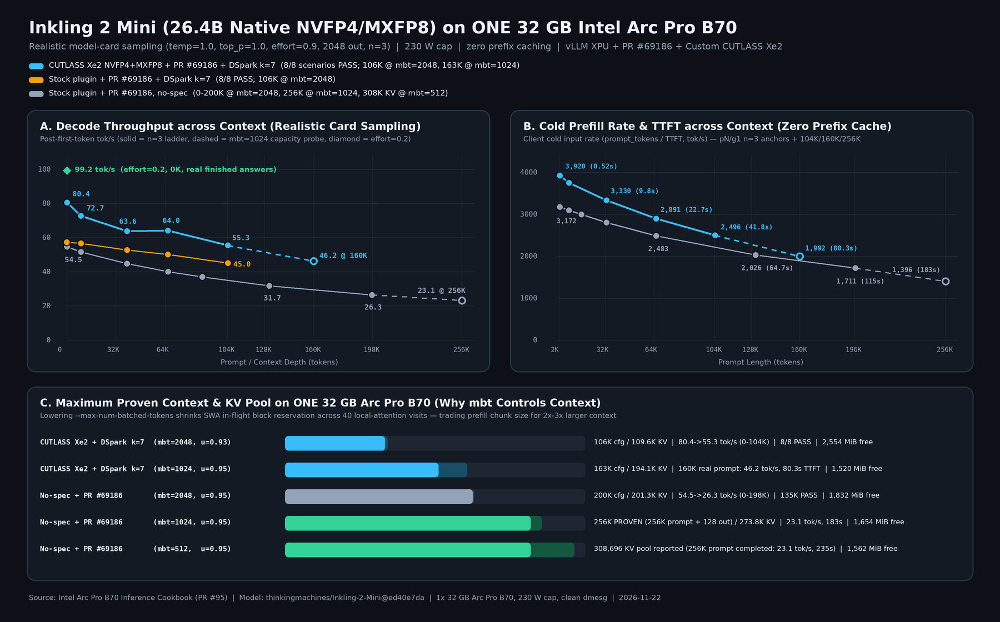

# Inkling 2 Mini on Intel Arc Pro B70

Thinking Machines' [Inkling 2 Mini](https://huggingface.co/thinkingmachines/Inkling-2-Mini) on one 32 GB Intel Arc Pro B70.
Updated 2026-11-22: **strictly isolated engine routes** (do not mix engines, checkpoints, patches, scheduler chunk sizes, or metric classes across rows).

## Pick one route

| Route | Artifact | Status | Cold Prefill (TTFT / rate) | Decode (model-card sampling) | Context proven | Guide |
|---|---|---|---|---|---|---|
| **vLLM XPU + PR `#69186` + Opt-in CUTLASS Xe2 + DSpark `k=7` (Fastest 1x B70)** | Native `thinkingmachines/Inkling-2-Mini@ed40e7da` (NVFP4/MXFP8 experts, BF16 dense/KV) | **Opt-in speed profile (`INK2_CUTLASS_MOE=1`)**, 2026-11-22. Full `0`–`104K` ladder (`n=3`), **8/8 exact/retrieval tasks PASS** (`33.8K` in `11.1 s`) | **3,920 to 2,496 tok/s** (2K: `0.52 s`, 8K: `2.19 s`, 32K: `9.84 s`, 64K: `22.7 s`, 104K: `41.8 s`; 160K @ `mbt=1024`: `1,992 tok/s`) | **80.4 / 72.7 / 63.6 / 64.0 / 55.3 tok/s** at `0 / 8K / 32K / 64K / 104K` (`effort=0.2` 0K: **99.2 tok/s**; 160K probe: **46.2 tok/s**) | **106,496** (`mbt=2048`) / **163,840** (`mbt=1024`, `160K` proven) | [INKLING2-MINI-VLLM-XPU.md](INKLING2-MINI-VLLM-XPU.md) |
| **vLLM XPU + `vllm-inkling2-xpu` + PR `#69186` (Stock no-spec, Max Context)** | Native `thinkingmachines/Inkling-2-Mini@ed40e7da` | **Primary stock 1x B70 route** (2026-11-22). Full `0`–`198K` ladder (`n=3`), 8/9 exact tasks including **135K retrieval PASS** | **3,172 to 1,711 tok/s** (2K: `0.65 s`, 8K: `2.65 s`, 64K: `26.4 s`, 128K: `64.7 s`, 196K: `114.9 s`; 256K @ `mbt=1024`: `1,396 tok/s`) | **54.5 / 51.4 / 44.7 / 39.9 / 31.7 / 26.3 tok/s** at `0 / 8K / 32K / 64K / 128K / 198K` (256K probe: **23.1 tok/s**) | **200,000** (`mbt=2048`) / **262,144 (256K)** (`mbt=1024`, **308.7K KV** @ `mbt=512`) | [INKLING2-MINI-VLLM-XPU.md](INKLING2-MINI-VLLM-XPU.md) |
| **TensorFold XPU** (`tag b70-inkling2-mini-20261121`) | Unsloth `UD-Q4_K_XL` GGUF | Research build (2026-11-21); not upstream. Fast short/8K decode, slow cold prefill; KL not yet measured | 104.8 s TTFT at 9,172 tokens (87.6 tok/s engine) | 71.48 / 64.05 tok/s at `76 / 9,172` tokens (2,048-token replies) | 16,384 (tag measured) | [INKLING2-MINI-TENSORFOLD.md](INKLING2-MINI-TENSORFOLD.md) |
| **llama.cpp SYCL** (+2 PRs +6 patches, `0002` masked) | Unsloth `UD-Q4_K_XL` GGUF | Research recipe (2026-11-21); bit-exact against its 0001-only build (KL 0, greedy 5/5) | 54.4 s TTFT at 9,172 tokens (0001-only control) | 29.09 / 25.14 tok/s at `76 / 9,172` tokens (1,024-token replies) | 49,152 (allocated) | [INKLING2-MINI-LLAMACPP.md](INKLING2-MINI-LLAMACPP.md) |

Do not mix: the vLLM XPU routes load the unmodified official safetensors checkpoint directly; the TensorFold and llama.cpp routes load `UD-Q4_K_XL` GGUF. Patch stacks apply only to their named engine base commit.

## Model facts (`thinkingmachines/Inkling-2-Mini` @ `ed40e7da`)

Revision `ed40e7da625f594fc9c4990f5f66be24873c22d7` (verified from `config.json` and safetensors header):

| Property | Value |
|---|---|
| Parameters | 26.4B total, 3.4B physical active per pass, 5.4B effective active across the 3-pass loop |
| Loop topology | 24 stored layers; core layers 6–17 execute 3 passes (48 layer applications per token) |
| MoE | 128 routed experts per layer, top-8 active, intermediate width 1,152, hidden size 2,304, vocab 201,024 |
| Attention | 1,048,576 model max length (not single-card B70 capacity); 20/24 layers use 1,024-token sliding window + relative-position bias |
| Native checkpoint format | NVFP4 routed experts (layers 0–19), MXFP8 routed experts (layers 20–23), BF16 dense/attention/embeddings/`lm_head`. No BF16 expert release exists |
| Drafter | Bundled 3-layer DSpark block drafter (`mtp.safetensors`, block 8; closed on llama.cpp SYCL in DNR-034; verified on vLLM XPU up to `106K` @ `mbt=2048` and `163K` @ `mbt=1024`) |
| Card sampling | `temperature=1.0`, `top_p=1.0` (`generation_config.json`); `reasoning_effort=0.9` default (reasoning cannot be fully disabled) |
| Licence | Apache-2.0 ([Model Acceptable Use Policy](https://thinkingmachines.ai/model-acceptable-use-policy/)) |

Intel Xe2 (Arc Pro B70) does not implement native FP4/FP8 DPAS. Packed NVFP4/MXFP8 weights save memory bandwidth and unpack to BF16/FP16 for XMX execution. Do not convert this checkpoint to GPTQ INT4 (`DNR-009`, `DNR-041`), EXL3 (`DNR-035`), or larger Q8/BF16 GGUFs (`DNR-040`).

## Evidence and records

- **vLLM XPU (primary + opt-in CUTLASS Xe2):** [`results/inkling2-mini/vllm-xpu-20261122/`](../../results/inkling2-mini/vllm-xpu-20261122/README.md), [`patches/inkling2-mini-vllm-xpu/APPLY.md`](../../patches/inkling2-mini-vllm-xpu/APPLY.md)
- **TensorFold XPU (research):** [`results/inkling2-mini/tensorfold-xpu-20261121/`](../../results/inkling2-mini/tensorfold-xpu-20261121/README.md)
- **llama.cpp SYCL (research):** [`results/inkling2-mini/llamacpp-sycl-20261121/`](../../results/inkling2-mini/llamacpp-sycl-20261121/README.md), [`patches/inkling2-mini-llamacpp/APPLY.md`](../../patches/inkling2-mini-llamacpp/APPLY.md)
- **Launch scripts:** [`benchmarks/inkling2-mini/`](../../benchmarks/inkling2-mini/README.md)
- **Catalog authority:** `inkling2-mini-*` records in [`data/benchmarks.v1.json`](../../data/benchmarks.v1.json)
- **Closed arms:** `DNR-034` to `DNR-042` in [`docs/DO-NOT-REPEAT.md`](../DO-NOT-REPEAT.md)
- **Optimization method:** [`docs/OPTIMIZATION-PLAYBOOK.md`](../OPTIMIZATION-PLAYBOOK.md)
