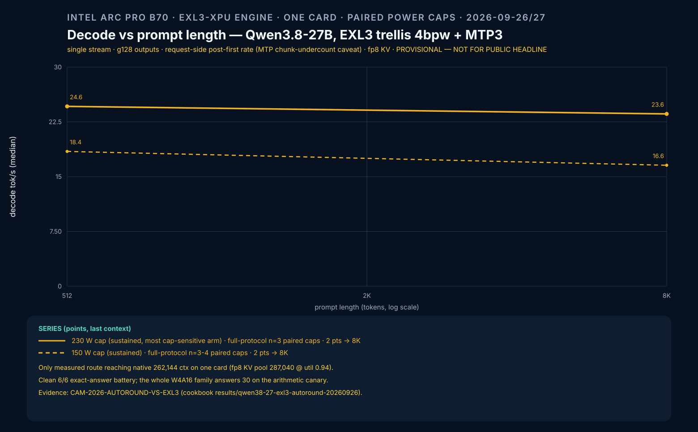
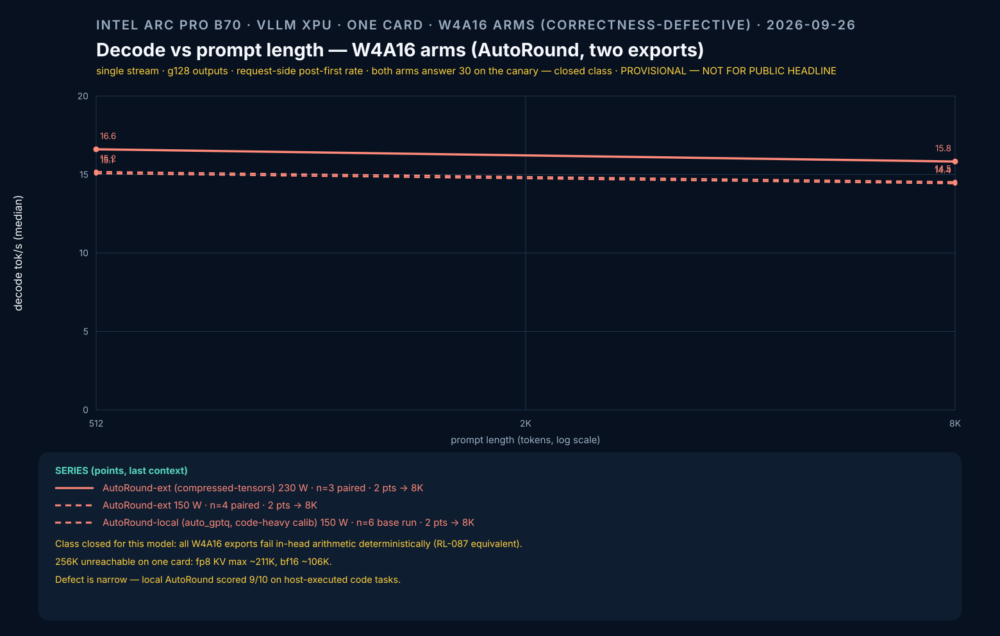

# Qwen3.8-27B on one B70 via EXL3 (exl3xpu engine)

> Route record — measured on the re-measure campaign `CAM-2026-AUTOROUND-VS-EXL3`
> (2026-09-26/27, official-lab self-report). This is the **primary single-card
> serving route** for Qwen3.8-27B on this host family. It supersedes the removed
> GPTQ-INT4 artifact; the W4A16/GPTQ class is closed for this model (see
> *Verdict* below).

## What it is

[exl3xpu](https://github.com/0xSero/exl3xpu) — a vLLM XPU fork carrying
turboderp's ExLlamaV3 **trellis** quantization (`EXL3`) with native ESIMD
kernels on Battlemage, plus `qwen3_5_mtp` speculative decoding (native MTP3).
It is NOT the mainline vLLM image — treat it as its own engine.

- Image (pinned): `ghcr.io/0xsero/exl3xpu@sha256:21412bdd7535e9c653eeb3d099dce3bc79a83d440def2cd9556111c79c870fa8`
  — vLLM `0.26.1.dev0+g568afb3a1` inside, ~32 GB.
- Weights (pinned): `turboderp/Qwen3.8-27B-exl3` rev `113cf7ab` — 4.00 bpw,
  ~15.7 GiB, MTP3 tensors, fp8 KV, native 262,144 context, vision tower.
- Hardware: 1× Intel Arc Pro B70 (32 GiB). Tested on 2×B70 host using card 0.

## Measured (one B70, 2026-09-26/27)

| Axis | Result |
|---|---|
| Exact-answer battery (greedy, thinking off) | **6/6 clean** — `sum(i*i for i in range(4))` = 14 twice, 9×7−3 = 60 |
| Host-executed task battery (5 bugfix + 5 codegen, cache ON) | 8/10 |
| Decode, sustained chunk-rate median n=3 | p512/g128: 18.4 @150 W → 24.6 @230 W · p8192/g128: 16.6 → 23.6 |
| Cap sensitivity | **+33–42 % at 230 W (paired medians)** — most power-limited arm measured |
| Context on ONE card | **native 262,144 boundary proven** — 261,920-token prompt answered correctly (pool 287,040 @fp8 KV, util 0.94); cold 258K prompt 389 s |
| Prefix cache (10,546-token shared prefix, n=5) | 8.11 s cold → ~1.5 s cached = **5.4×** |
| Interactive-HTML battery r3 (3 math-viz prompts ×4 runs, real-time functional verify) | fluid 0/4 · parametric 1/4 · orbits 3/4 clean (1 partial) — codegen variance |
| Interactive-HTML battery r4 (harder prompts incl. raw WebGL2, card sampling + thinking=low) | **2/3** — fluid-sim with obstacles ✅ · strange-attractor explorer ✅ · 3D flow-field ✗ (GLSL syntax error) |
| Effective decode bandwidth | ~240 GB/s @150 W → ~355 GB/s @230 W |





Numbers you must not mix: the decode figures are MTP chunk-rates (accepted
steps — they undercount generated tokens); compare within the campaign's
own arms only. The upstream ~400 GB/s full-decode figure and the 91 % lm_head
microbench are different cells on the author's stack.

**Why it wins despite lower bandwidth:** OpenVINO int4 streams ~414 GB/s at
150 W — closer to the 608 GB/s roofline — but EXL3 is the only measured route
that is simultaneously correct (clean battery), fits 256K on one card, keeps
the smallest resident footprint (15.7 GiB → ~76K more fp8-KV tokens than
equal-fp8 AutoRound), and scales hardest with the power cap.

## Serving recipe

```bash
# isolated daemon (the image is ~32 GB; keep it off your main dockerd's
# root disk). One-time:
sudo systemd-run --unit=b70-exl3-dockerd --description='isolated EXL3 dockerd' \
  dockerd -H unix:///run/b70-exl3-docker.sock \
  --data-root /mnt/b70-exl3-docker \
  --bridge b70-exl3-br0 --iptables

export DOCKER_HOST=unix:///run/b70-exl3-docker.sock
docker pull ghcr.io/0xsero/exl3xpu@sha256:21412bdd7535e9c653eeb3d099dce3bc79a83d440def2cd9556111c79c870fa8

docker run -d --name b70-exl3 -p 8100:8100 \
  --device /dev/dri --group-add $(stat -c '%g' /dev/dri/renderD128) \
  -v /dev/dri/by-path:/dev/dri/by-path:ro \
  -v <models_dir>/b70-exl3-qwen38-4bpw:/mnt/exl3model:ro \
  -e ZE_FLAT_DEVICE_HIERARCHY=COMPOSITE \
  ghcr.io/0xsero/exl3xpu@sha256:21412bdd7535e9c653eeb3d099dce3bc79a83d440def2cd9556111c79c870fa8 \
  models/qwen3.8-27b-exl3-4.00bpw --gpu 0 --model-path /mnt/exl3model \
  --set vllm.gpu_memory_utilization=0.90 --set vllm.max_model_len=65536
```

Startup ≈ 6–7 min (JIT + graph capture). `GET :8100/v1/models` is the health
probe. OpenAI-compatible chat completions.

Traps already priced in:

- **Isolated daemon is mandatory on a small root disk** — a 32 GB image pull
  under the containerd snapshotter writes to `/var/lib/containerd`; force
  overlay2 (`"features":{"containerd-snapshotter":false}` in daemon.json) or a
  big-disk `--data-root`.
- **`serve.py` takes a config positional** — `models/<id>` + `--set k=v`
  overrides. Bare vLLM flags are rejected.
- **gmu 0.965 OOMs on a dirty card** — 0.90 is the safe default; 0.94 on a
  clean card for capacity probes.
- **fp8 is the only KV dtype** — bf16 KV is rejected at capture warmup.
- **Prefix caching is ON by default** — do not benchmark cold cells without
  the entropy-guard protocol.

## Mixed-bit SC_5.00bpw_H6 (quality pick)

Same engine, different weights and a patched image: turboderp's
[SC_5.00bpw_H6](https://huggingface.co/turboderp/Qwen3.8-27B-exl3/tree/SC_5.00bpw_H6)
branch mixes trellis rates K=4–7 instead of flat 4.00 bpw — higher effective
quality for ~0.89× the decode speed.

- Weights (pinned): `turboderp/Qwen3.8-27B-exl3` @
  `dfe2f4fd71bf9a1994051d4d47e6460fa96dd723` (~20 GB), branch `SC_5.00bpw_H6`.
- Image (pinned): `ghcr.io/sergiiob/exl3xpu-mixedk:20261012c@sha256:7bb0c5cfed8a35da8f4db0034338d8dbe5f53731253d96ea8f1db2b5bddd4a40`
  — the 0xSero `0.1.0` base above plus the mixed-K patch set published at
  [`SergiioB/exllamav3` `b70/`](https://github.com/SergiioB/exllamav3/tree/244f57e5c220a5ea6e438869fa996c5b7e96ca75/b70);
  that README lists every kernel check. Same `serve.py` entrypoint and the
  same serve_config `models/qwen3.8-27b-exl3-4.00bpw` — the SC5 model dir is
  passed via `--model-path` exactly as in the recipe above.
- Launcher recipe: `qwen38-27b-sc5` (engine `exl3`).

Measured on one B70 (mixed-K image, 230 W cap, ~230 W measured draw). Every
number below traces to a record in
[`data/benchmarks.v1.json`](../../data/benchmarks.v1.json) backed by the
[`sc5-mixedk-ab-20261012`](../../results/qwen38-27b/sc5-mixedk-ab-20261012/)
evidence generation.

| Axis | Result | Record |
|---|---|---|
| Mixed-K kernel checks | **46/46** — the fork README enumerates them | `qwen38-27-exl3xpu-sc5-v1` |
| Exact-answer canaries (greedy) | **6/6**, plus **3/3** long prompts (8,161–8,162 tokens) | `qwen38-27-exl3xpu-sc5-v1` |
| Configured context | `max_model_len` 65,536 at `gpu_memory_utilization` 0.90, MTP3, FULL_DECODE_ONLY graphs, fp8 KV | `qwen38-27-exl3xpu-sc5-v1` |
| Matched A/B vs plain 4.00bpw — n=5 per arm, ABBA, recipe sampling (temp 0.7 / top_p 0.8 / top_k 20 / presence 1.5), MTP3, C1, g128, cold prefix cache | p524/g128: **56.62** vs 63.56 tok/s median (0.891×) | `qwen38-27-exl3xpu-sc5-p524-g128-c1` |
| Same protocol, 8K prompt | p8124/g128: **56.82** vs 64.34 tok/s median (0.883×) | `qwen38-27-exl3xpu-sc5-p8124-g128-c1` |
| Quality vs bf16 | **lower KL divergence than plain 4.00bpw** per turboderp's published chart on the [model card](https://huggingface.co/turboderp/Qwen3.8-27B-exl3) | qualitative, `qwen38-27-exl3xpu-sc5-v1` |

The A/B compares each quant on its route-of-record stack: the plain-4.00bpw
arm ran the published upstream `0xsero/exl3xpu:0.1.0` image, the SC5 arm the
mixed-K patched image. Do not mix these decode figures with the chunk-rate
table above: this A/B was measured at client post-first tok/s under recipe
sampling, not MTP chunk-rate.

Launcher smoke on SC5 (2026-10-13, `b70 launch qwen38-27b-sc5`): 6/6 canaries,
3/3 long prompts and a 4-turn prefix-cache session up to 15,600 tokens passed
([evidence](https://github.com/SergiioB/intel-arc-pro-b70-inference-cookbook/tree/026b2a559626b4f957d5ac52a5844c9c7590c733/results/qwen38-27b/sc5-launcher-smoke-20261013)).
Not yet proven on SC5: sessions longer than ~15.6K tokens.

Public evidence:

- Compiled canonical numbers (per-arm medians, MTP acceptance, power,
  correctness, protocol):
  [`summary.json`](../../results/qwen38-27b/sc5-mixedk-ab-20261012/summary.json)
- Sanitized per-sample rows (token counts, timing, spec-decode deltas,
  energy-derived W):
  [`recipe-ab-samples.jsonl`](../../results/qwen38-27b/sc5-mixedk-ab-20261012/recipe-ab-samples.jsonl)
- Generation manifest and arm identities:
  [`README.md`](../../results/qwen38-27b/sc5-mixedk-ab-20261012/README.md)
- Public catalog authority:
  [`data/benchmarks.v1.json`](../../data/benchmarks.v1.json)

## The closed alternative (verdict, not recipe)

The W4A16/GPTQ family (symmetric int4 g128) is **closed for this model**:
GPTQModel, AutoRound→compressed-tensors, and local AutoRound→auto_gptq all
return `30` on the arithmetic canary while the BF16 base answers 14 via TP2
control. They are also the slowest arms (~15–16.5 chunk-rate) and cannot fit
256K (fp8 max ~211K). Narrow defect: in-head numeric evaluation only — the
local AutoRound still scored 9/10 on host-executed code tasks. On the harder
round-4 HTML battery (raw WebGL2 included, card sampling, thinking=low) it
managed **1/3** — a `seg` ReferenceError and a duplicate-`const` SyntaxError on
the two WebGL cases.

**New defect found on this stack: W4A16 × prefix-cache corruption.** With
`--enable-prefix-caching` on the vLLM-XPU compressed-tensors route, repeated
shared-prefix prompts degenerate into token salad mid-generation (8/9 cases
across a 3-run battery). Same server and prompts with prefix caching OFF
produce complete coherent output every time. Until this is isolated upstream,
run W4A16 exports on this stack with prefix caching disabled — and note this
is additive to the known arithmetic defect, independent of it.

## Alternate route

OpenVINO int4-ov ([OPENVINO-CASCADIA-REPORT.md](OPENVINO-CASCADIA-REPORT.md)) —
clean correctness, best steady-150 W decode (~28.5 tok/s at the practical
bandwidth roofline), but MTP draft is off ≥98K and the thinking-mode
generation budget handicaps long structured outputs (4/10 on the exec battery).

## Evidence

Campaign: `results/qwen38-27-exl3-autoround-20260926/summary.json`
(per-arm table, incident log). Task battery, cache probe, cap-pair and KV
probes are in the private lab repo `B70-DOCS
results/2026/09/autoround-vs-exl3-20260926/` (RESULTS.md is the full matrix).
