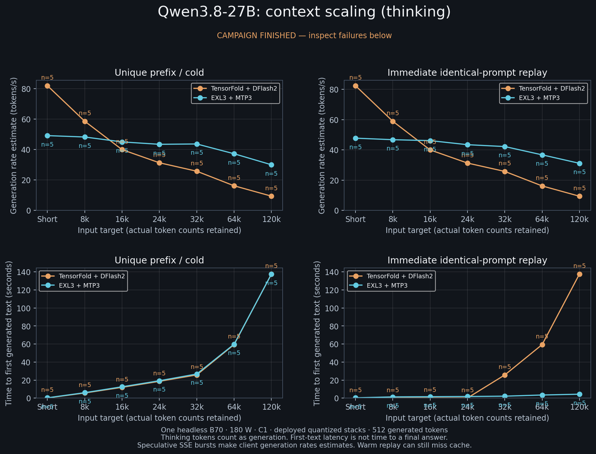
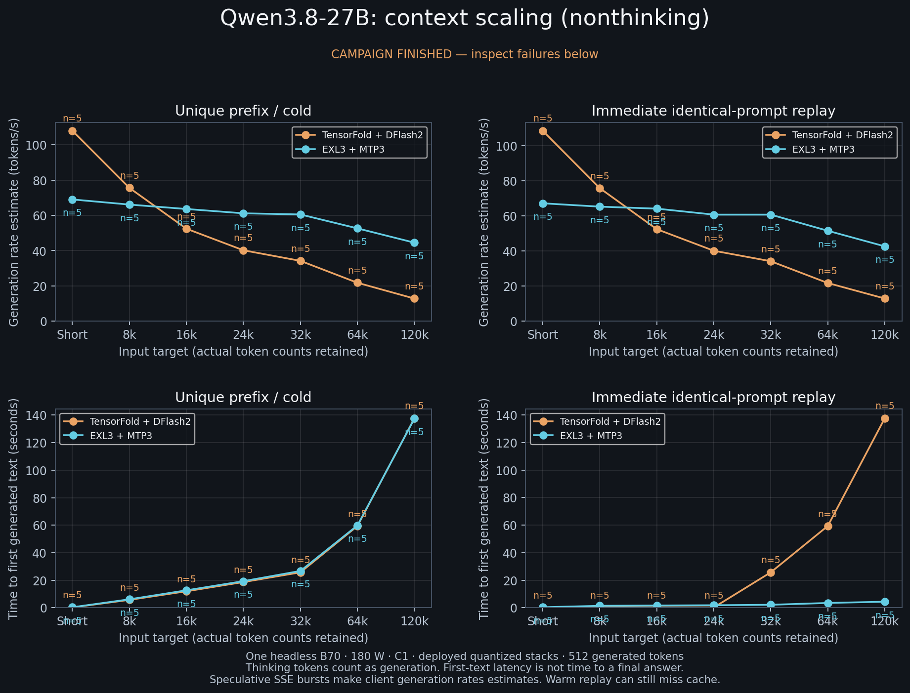
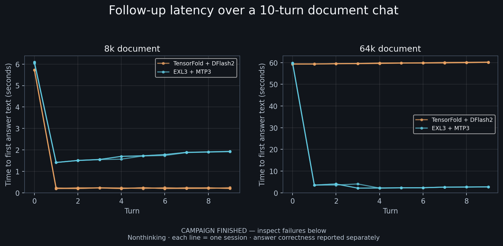
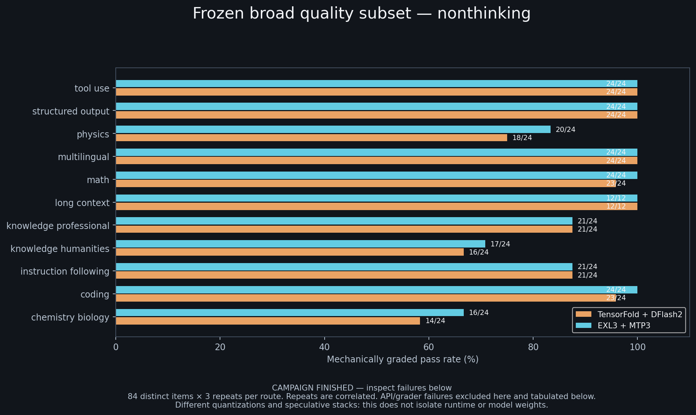

# Qwen3.8-27B on one B70: EXL3 vs TensorFold, matched confirmation

Measured 2026-11-11 on one headless Intel Arc Pro B70 32 GB (GPU 1, 180 W cap),
one request at a time unless labelled, prefix cache on. This is a **supplemental
matched confirmation**, not a catalog record. It does not change
`data/benchmarks.v1.json`, the family recommendation, or the 2026-11-10 screen.
Raw cells, hashes, charts and provenance:
[`results/qwen38-27b/route-confirmation-20261111/`](../../results/qwen38-27b/route-confirmation-20261111/).

The compared objects are the deployed stacks, not the engines in isolation:

| Stack | Artifact | Context | Speculation | Cache |
|---|---|---:|---|---|
| EXL3 4.00 bpw + MTP3 | EXL3 4.00 bpw artifact, `intel/llm-scaler-vllm:0.26.0-b2` | 262,144 | native MTP3 | prefix cache on |
| TensorFold 4-bit g64 + DFlash2 | `Qwen3.8-27B-MLX-4bit`, tensorfold-native 1.2.5 | 131,072 | DFlash2 | 2 GiB prompt cache |

Sampling was the model card's: thinking T1.0 / top_p 0.95 / top_k 20; matched
non-thinking T0.7 / top_p 0.8 / top_k 20. TensorFold cannot execute the card's
non-thinking `presence_penalty=1.5`, so both stacks used 0 for the matched
non-thinking cells. Speed probes generated 512 tokens; quality probes used an
8,192-token cap. Each speed cell used one discarded same-shape warmup and five
fresh paired prompts where available. Cold prompts begin with unique entropy;
warm cells are explicit identical-prompt replays.

## Result

**There is no universal winner. Choose by prompt length and cache state.**

- **Short prompts, about 0–8K:** TensorFold is faster. At 0 tokens it generated
  about 1.6x faster in both modes; at 8K thinking it was about 1.2x faster. The
  8K non-thinking cold difference was not resolved; the warm replay favoured
  TensorFold.
- **Intermediate and long prompts, 16K–120K:** EXL3 is faster. The resolved
  advantage grows from about 1.2x at 16K to 1.7–2.4x at 32–64K and 3.3–3.5x at
  120K. The 16K thinking cold cell was not resolved.
- **Long documents and multi-turn chat:** EXL3 is the practical choice. It serves
  262,144 tokens and its prefix cache held through 120K; TensorFold serves
  131,072 and its 2 GiB prompt cache stopped retaining at 32K. A 64K follow-up
  therefore started answering in a median 2.6 s on EXL3 versus 59.8 s on
  TensorFold.
- **Quality:** the confirmation does **not** establish a quality winner. The
  broad 84-item subset slightly favoured EXL3; the stricter 40-item floor
  slightly favoured TensorFold in thinking mode. Retrieval passed on both.
- **Concurrency:** both stacks scaled similarly at C2/C4; all measured requests
  succeeded. This is aggregate throughput, not single-user decode.

For the current first-run recipe, keep EXL3 as the general and long-context
default, and choose TensorFold when the workload is short-prompt, latency-first,
and fits its 131K context and cache limits. The launcher already defaults to the
EXL3 route; this confirmation supports that default for long context without
turning it into a universal quality or speed claim.

## Speed

Code-corpus prompts, 512 generated tokens, five paired prompts per cell. The
table is the paired mean of `EXL3 rate / TensorFold rate`; **> 1 means EXL3 is
faster, < 1 means TensorFold is faster**. `n/r` means the pointwise interval did
not resolve a 10% difference.

| Input | Thinking cold | Thinking replay | Non-thinking cold | Non-thinking replay |
|---:|---:|---:|---:|---:|
| 0 | 0.62 | 0.59 | 0.64 | 0.63 |
| 8K | 0.82 | 0.80 | 0.89 (n/r) | 0.86 |
| 16K | 1.14 (n/r) | 1.17 | 1.21 | 1.24 |
| 24K | 1.35 | 1.40 | 1.51 | 1.48 |
| 32K | 1.72 | 1.69 | 1.70 | 1.70 |
| 64K | 2.33 | 2.28 | 2.45 | 2.41 |
| 120K | 3.27 | 3.34 | 3.48 | 3.36 |

Cold time to first generated text was effectively a prefill measurement and was
nearly identical between the stacks at each depth: about 0.2 s at 0, 5.7–6.1 s
at 8K, 25.7–26.8 s at 32K, and 137.5–137.7 s at 120K. The speed difference is
decode rate, not prefill. Absolute cold generation rates at selected depths
(EXL3 / TensorFold, tokens/s, client post-first estimate):

| Input | Thinking | Non-thinking |
|---:|---:|---:|
| 0 | 49.2 / 82.0 | 69.0 / 108.0 |
| 32K | 43.7 / 25.8 | 60.5 / 34.2 |
| 120K | 30.0 / 9.4 | 44.5 / 12.9 |

The independent prose corpus (3 pairs per depth, supplementary) was
inconclusive at 8K, 32K and 120K; its ratios were 1.05, 2.0 and 4.2. Three pairs
are not five, so do not read a prose crossover from it.

## Cache behaviour

Warm replay is the same prompt sent again after the first response. TensorFold's
2 GiB cache held through 24K and missed from 32K; EXL3's cache held through the
full 120K test. Median warm time to first generated text:

| Input | EXL3 | TensorFold |
|---:|---:|---:|
| 8K | 1.3–1.4 s | 0.1 s |
| 24K | 1.8 s | 0.1 s |
| 32K | 2.1–2.2 s | 25.7 s |
| 64K | 3.4 s | 59.4 s |
| 120K | 4.3 s | 137.6 s |

This is the main reason the ten-turn chat result diverges at 64K: TensorFold's
cache miss makes every follow-up pay near-cold prefill, while EXL3 still reuses
the document prefix. It is a cache-capacity effect, not a decode-rate effect.

## Quality and delivery

The 40-item mechanical floor used the same full-answer grader for both stacks,
three repeats and both modes. Two EXL3 non-thinking responses were excluded
because the server returned HTTP 200 with 29 completion tokens but no visible
content; the same prompt with the first seed returned a complete tool call. They
are not scored as model failures.

| Suite | EXL3 | TensorFold | Boundary |
|---|---:|---:|---|
| 40-item floor, thinking | 119/120 | 120/120 | three repeats; small fixed suite |
| 40-item floor, non-thinking | 112/118 | 114/118 | two EXL3 pairs excluded; 118 paired |
| 84-item audited subset, non-thinking | 227/252 | 220/252 | +2.8 pp EXL3; pointwise 95% interval +0.8 to +5.2 pp; not multiplicity-adjusted |
| Harder Python, executed | 2/9 | 3/9 | three tasks × three repeats; small n |

The 2026-11-10 screen reported EXL3 highest on its 40-item sampled battery
(35/35/36 versus TensorFold 33/30/34). The stricter full-answer floor in this
confirmation did not reproduce that ordering: TensorFold was 120/120 and EXL3
119/120 in thinking. Treat the earlier battery ordering as a screen result, not
a confirmed quality advantage. The broad subset points the other way slightly;
neither suite is large enough to rank close routes.

**Retrieval** at 32K, 120K, near-limit and (EXL3 only) 240K passed 3/3 planted
codes in every one of 21 probes. The first analysis scored fenced JSON as a
failure; a post-hoc re-grade of the retained answers, without rerunning
inference, makes all 21 pass. **Sessions** passed 120/120 turns after the same
fence-strip correction. Median follow-up time to first answer text:

| Document | EXL3 | TensorFold |
|---|---:|---:|
| 8K, 10 turns | 1.7 s | 0.2 s |
| 64K, 10 turns | 2.6 s | 59.8 s |

**Concurrency** at 32K total context, five retained batches after warmup:

| Stack | C2 aggregate tok/s | C4 aggregate tok/s | Failed requests |
|---|---:|---:|---:|
| EXL3 + MTP3 | 48.2 | 56.1 | 0 |
| TensorFold + DFlash2 | 49.1 | 55.7 | 0 |

Aggregate throughput is not single-user decode, and the small sample does not
establish a tail-latency SLO.

**Greedy repeatability:** on five fixed prompts, three repeats per arm, each
stack produced one stable output per prompt. TensorFold draft-on and draft-off
were byte-identical; EXL3 MTP3 and serial were byte-identical. EXL3 and
TensorFold differed on 2 of 5 prompts. This is a five-prompt within-arm check,
not a replacement for the existing 329-item parity record, and it does not
establish universal losslessness.

## What changed from the screen

- The speed shape is confirmed and the crossover is bounded: TensorFold at
  0–8K, EXL3 from 16K, with the 16K thinking cold cell unresolved. The screen
  could only say "between 8K and 32K".
- TensorFold's 2 GiB cache limit is confirmed: retained through 24K, missed at
  32K and above. This is now a measured chat limitation, not an inference.
- The screen's retrieval claim is confirmed after fixing a fenced-JSON grader;
  the first analysis's 120K/240K "failures" were parser failures, not model
  failures.
- The screen's 40-item battery ordering is not confirmed under the stricter
  grader. Quality remains unresolved between the routes.
- The two EXL3 empty-content tool-call responses are a server visibility issue:
  usage counted 29 completion tokens, but the stream exposed no content, tool
  call or reasoning. They are excluded, not scored.

## Limits

- One card, one host, one 180 W cap, one kernel and one driver session. A second
  card, a different cap, or a different driver can change absolute rates.
- The stacks differ in quantization (EXL3 4.00 bpw versus MLX affine 4-bit g64)
  and speculation (MTP3 versus DFlash2). This compares deployed stacks; it does
  not isolate engine, quantization or drafter effects.
- Code-corpus prompts for depth; the prose corpus has only three pairs and was
  inconclusive. Chat-style and code-style workloads can cross over differently.
- Five paired prompts per speed cell; intervals are pointwise and not
  multiplicity-adjusted. A resolved cell is a statement about these frozen
  prompts and this host, not every workload.
- The quality suites are small and correlated within item. The broad subset
  favours EXL3 slightly; the stricter floor favours TensorFold slightly. No
  universal quality winner is claimed.
- TensorFold returns HTTP 400 for the card's non-thinking presence penalty 1.5;
  the matched cells used 0. Tool-call support differs by server. The two EXL3
  empty-content tool responses show that a 200 response with token usage is not
  proof that content was delivered.
- Client post-first generation rates include speculative bursts and are
  estimates, not engine-native decode counters. Time to first generated text is
  not time to a final answer when thinking is enabled.

## Charts

## Reproduction and evidence

- `summary.json` — derived counts, speed cells, paired comparisons, quality,
  sessions, retrieval, hard code, parity, concurrency.
- `speed-cells.csv` — every speed cell with n, rate, TTFT, first-answer time,
  energy and truncation.
- `quality.json`, `retrieval.json`, `sessions.json`, `hard-code.json`,
  `parity.json`, `concurrency.json` — compact retained evidence.
- `provenance.json` — image digest, model and binary hashes, kernel, power cap,
  sampling and protocol.
- `charts/` — context scaling, multi-turn latency and quality-by-area PNG/SVG.
- `HARNESS.md` — measurement definitions and the public scripts.

The raw requests, SSE streams, token usage and cache counters remain outside
this repository. No private host path, lab tree or credential is published.

No canonical benchmark figure was changed. This generation is supplemental
evidence; the catalog remains the authority for any number that enters a
leaderboard, recipe promotion or `data/benchmarks.v1.json`.
