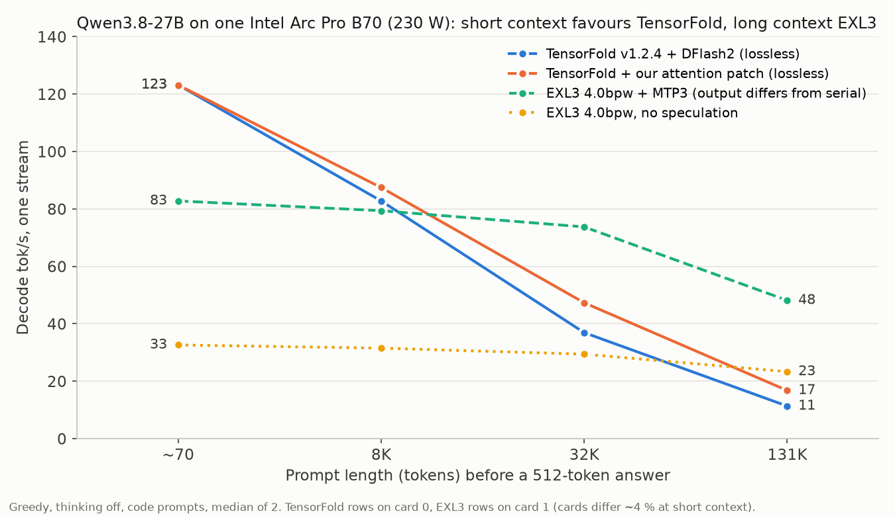

# Qwen3.8-27B on one B70 with TensorFold: lossless 123–128 tok/s, and what context does to it

Measured 2026-11-08 on two Intel Arc Pro B70 cards, one stream per card. Status: **screen**
(two repeats per cell, one host). Raw cells, prompts, scripts and patches:
[`results/qwen38-27b/tensorfold-depth-20261108/`](../../results/qwen38-27b/tensorfold-depth-20261108/).



## Pick a route

| Your prompts | Use | Why |
|---|---|---|
| Up to ~8K tokens (chat, short code tasks) | **TensorFold + DFlash2** | 123–128 tok/s on code, 98–102 on prose, and the drafted output is byte-identical to non-drafted greedy output |
| 32K and longer (agents with big context, repo dumps) | **EXL3 4.0 bpw + MTP3** (exl3xpu) | 74 tok/s at 32K and 48 at 131K, with 1.5–1.7× TensorFold's prefill, but MTP3 changes the output |
| Long context and you need the model's own greedy answer | EXL3 without speculation, or TensorFold with drafts off | 23 tok/s at 131K (EXL3) vs 19 (patched TensorFold, serial) |

## Results (code prompts, 512-token answers, decode tok/s after the first token)

Card 1, 230 W cap, stock engines:

| Prompt tokens | TensorFold drafted | TensorFold serial | EXL3 + MTP3 | EXL3 serial |
|---|---|---|---|---|
| 68 | **128.3** | 32.0 | 82.8 | 32.6 |
| 7,976 | **85.1** | 30.4 | 79.4 | 31.5 |
| 32,552 | 37.3 | 23.4 | **73.8** | 29.4 |
| 130,856 | 11.4 | 12.8 | **48.2** | 23.3 |
| Prefill tok/s at 32K | 1,475 | | 2,455 | 2,526 |
| J/token at 68 tokens | **1.70** | 6.46 | 2.79 | 7.06 |

Chat-style prompts run 15–25 % slower on both speculative routes (lower draft acceptance) and
the same on serial ones. Full table with chat rows, power and TTFT:
[`summary-gpu1-230w.md`](../../results/qwen38-27b/tensorfold-depth-20261108/summary-gpu1-230w.md).

### Lossless means byte-identical

Same frozen prompts, greedy, thinking off, compared by sha256 of the answer text:

- **TensorFold:** drafted, drafted again and `"draft": false` gave identical text in 8/8 cells
  (and repeats were identical). Stock and patched builds also matched across both cards.
- **EXL3:** MTP3 output differed from MTP-off output in 8/8 cells, and two MTP-off runs of the
  same prompt differed in 7/8 cells. Its speed is real; its output is not the model's
  reproducible greedy answer.

Exact-answer battery (6 canaries + 3 prompts at ~8K): TensorFold stock 9/9, patched 9/9.

## Why TensorFold slows down with context, and a patch (+49 % at 128K)

Draft acceptance is flat with depth (about 100 verify rounds per 512 tokens at every depth),
but each round costs 42 ms at 68 tokens, 138 ms at 32K and 420 ms at 131K. The decode
attention kernel re-reads the full K/V cache once per tree row (about 15 rows per round) and
writes fp32 partials for every 32-key slice: ~177 GB of traffic per round at 131K.

Our patch (two small changes, [`tree-attn-row-split.patch`](../../results/qwen38-27b/tensorfold-depth-20261108/patches/tree-attn-row-split.patch)):

1. Dispatch the tree rows of one key slice back to back, so they share it in L2.
2. Widen slices for long rows (32 keys below position 8K, 128 below 64K, 256 above), chosen by
   each row's own position, so drafted and serial decoding still use the same slices and
   stay bit-identical.

Same card (0), 230 W, stock v1.2.4 vs patched:

| Prompt tokens | code stock | code patched | chat stock | chat patched | card W stock → patched |
|---|---|---|---|---|---|
| 68 | 123.2 | 123.2 | 98.5 | 98.5 | 179 → 179 |
| 7,976 | 82.8 | **87.5 (+6 %)** | 66.0 | **70.2 (+6 %)** | 188 → 176 |
| 32,552 | 36.9 | **47.3 (+28 %)** | 27.3 | **35.0 (+28 %)** | 204 → 189 |
| 130,856 | 11.4 | **16.8 (+48 %)** | – | 15.0 | 214 → 194 |

J/token at 131K falls from 18.9 to 11.5. Patched serial decode at 131K is 19.0 tok/s (stock
12.8), which is faster than patched drafting (16.8): above ~64K, turn drafts off. A 180 W
repeat on the same card gave the same gains (+29 % / +49 %). A local-memory variant that
loads each slice once for all rows was 5× slower and is not included.

The patch is offered upstream to TensorFold; until it merges, apply it to v1.2.4 yourself
(below).

## Reproduce

```bash
# TensorFold v1.2.4, Intel Level Zero build (Zig 0.17.0, ocloc 26.05)
git clone https://github.com/ashhart/TensorFold && cd TensorFold && git checkout v1.2.4
git apply /path/to/local-patch.diff            # drops a 128-GRF flag ocloc 26.05 rejects (Gemma 4 kernels only)
git apply /path/to/tree-attn-row-split.patch   # optional: the long-context patch above
zig build xpu-native -Doptimize=ReleaseFast -Dngen-include=/path/to/onednn/third_party/ngen   # ~2.5 min

# weights: TensorFold/Qwen3.8-27B-MLX-4bit @22d8d538, drafter z-lab/Qwen3.8-27B-DFlash2
ZE_AFFINITY_MASK=1 ZE_FLAT_DEVICE_HIERARCHY=COMPOSITE zig-out/xpu/bin/tensorfold-native serve \
  Qwen3.8-27B-MLX-4bit --drafter Qwen3.8-27B-DFlash2 --parallel 1 --context 139264 \
  --prompt-cache-gib 0 --no-thinking --no-update-check --port 8036
# loads in ~7 s, 28.8 GB VRAM at 139K context
python3 depth_bench.py run --base http://127.0.0.1:8036 --model qwen --prompts prompts-qwen38.json \
  --out out --arm drafted --hwmon /sys/class/hwmon/hwmonN --depths 0,8k,32k,128k --reps 2
```

EXL3 rows: `exl3_depth_run.sh` (image `ghcr.io/sergiiob/exl3xpu-mixedk@sha256:933eda54…`,
turboderp 4.00 bpw weights, `max_model_len` 139264, prefix cache off), see [EXL3-XPU.md](EXL3-XPU.md).

## Claim boundary

- One stream, greedy, thinking off, 512-token answers, prefix cache off, two repeats per cell.
  Prompts are frozen text (llama.cpp source for code, this repo's docs for prose), sha256
  `74afe579…` for the whole set.
- Stock rows on card 1; the patch pair on card 0. At short context card 0 runs ~4 % below
  card 1 (123.2 vs 128.3), so compare within one table.
- The patched kernels ran on the bf16 KV cache, one stream. `XPU_KV_INT8=1` and concurrent
  streams were not measured. Quality was checked by the 9-case battery and byte identity,
  not by a task suite; an earlier 329-item screen put TensorFold within about one item of
  EXL3 4.0 bpw (MLX 4-bit g64 is a coarser format).
- Some card-0 cells ran while card 1 served another benchmark, and three low-priority
  (`nice 19`) engine compiles overlapped 11 timed cells (TensorFold serial repeat 1 at
  0–32K, two TensorFold cells around 128K, EXL3+MTP3 repeat 2 at 0–32K). Each of those cells
  matches its non-overlapped repeat within 1.3 %. Timeline:
  [`host-activity.txt`](../../results/qwen38-27b/tensorfold-depth-20261108/host-activity.txt).
