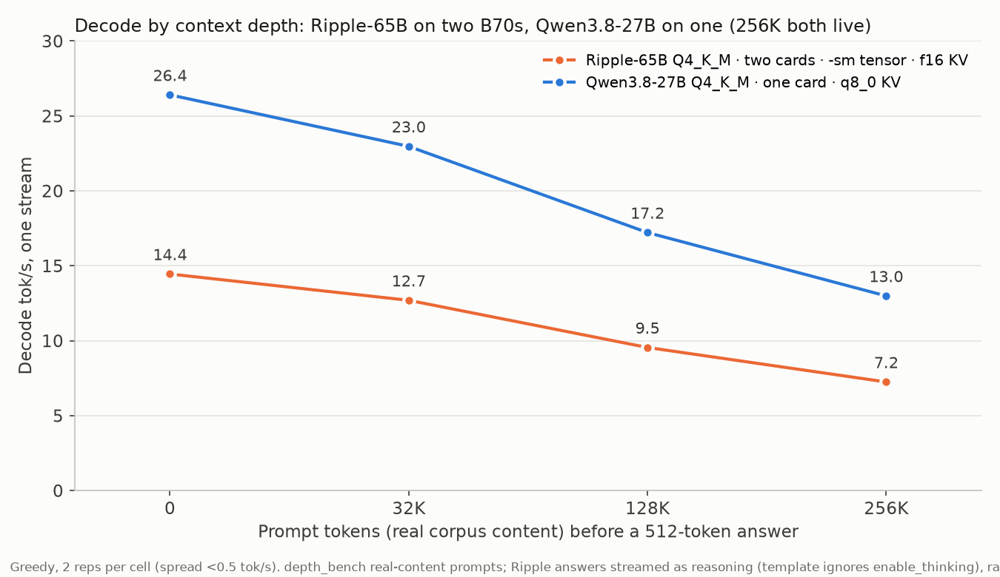

# Ripple-65B Preview on two Arc Pro B70 cards (llama.cpp SYCL)

Ricursive's [Ripple-65B Preview](https://huggingface.co/ricursiveAI/Ripple-65B-Preview)
(65B dense, Apache-2.0, released 2026-11-04) runs on two B70 cards with stock llama.cpp.
Use `-sm tensor` and **build llama.cpp with `GGML_SYCL_F16=ON`**: the flag nearly
triples prompt processing (720 vs 218 tok/s on `Q4_K_M`) and leaves decode unchanged.
Measured 2026-11-08, status **screen** (two repeats per cell, one where noted). Evidence:
[`results/ripple-65b/dual-b70-20261108/`](../../results/ripple-65b/dual-b70-20261108/)
(F16 off) and
[`results/ripple-65b/prefill-f16-20261108/`](../../results/ripple-65b/prefill-f16-20261108/) (F16 A/B).

| File · split · build | KV | Decode tok/s at 0 / 16K / 32K | Prefill tok/s (pp2048) at 0 / 16K / 32K |
|---|---|---|---|
| **`Q4_K_M` · `-sm tensor` · F16 ON** | f16 | **14.5 / 13.2 / 12.5** | **720 / 601 / 527** |
| `Q4_K_M` · `-sm tensor` · F16 OFF | f16 | 14.6 / 13.2 / 12.5 | 218 / 208 / 200 |
| `AD-IQ4_XS` · `-sm tensor` · F16 ON | f16 | 12.5 / 11.2 / 10.0 | 643 / 549 / 443 |
| `AD-IQ4_XS` · `-sm tensor` · F16 OFF | f16 | 13.2 / — / — | 214 / — / — |
| `AD-IQ4_XS` · `-sm layer` · F16 ON | q8_0 | 10.3 / — / — | 496 / — / — |

- The F16 build flag changes prefill only: `Q4_K_M` decode is 14.5–14.6 tok/s either way.
  On `AD-IQ4_XS` the F16 build costs ~0.7 tok/s of decode for the prefill win.
  Same commit (`b12195-3-gf477f795c`), rebuilt with `-DGGML_SYCL_F16=ON`.
  Use `-b 2048 -ub 2048`; at `-ub 512` the F16 build manages 643 tok/s pp on `AD-IQ4_XS`.
- Earlier numbers on this page (13.3 / 189 tok/s, F16 off, `pp512`) are superseded.

Quality smoke on the `-sm tensor` server: exact-answer battery 9/9 (6 canaries + 3 prompts
at ~8K tokens), and a `merge_intervals` coding prompt answered with code whose asserts pass
when executed. That is a smoke test, not a quality ranking.

## Serve it

```bash
# llama.cpp b12167 or newer (Ripple support, PR #31692); we used b12195-3-gf477f795c.
# Build with: cmake -S . -B build-sycl -DGGML_SYCL=ON -DGGML_SYCL_F16=ON \
#   -DGGML_SYCL_GRAPH=ON -DCMAKE_C_COMPILER=icx -DCMAKE_CXX_COMPILER=icpx \
#   -DCMAKE_BUILD_TYPE=Release -DLLAMA_CURL=OFF
curl -L -o Ripple-65B-Preview-Q4_K_M.gguf \
  https://huggingface.co/ricursiveAI/Ripple-65B-Preview-GGUF/resolve/main/Ripple-65B-Preview-Q4_K_M.gguf
source /opt/intel/oneapi/setvars.sh --force
ONEAPI_DEVICE_SELECTOR='level_zero:0,1' ZE_FLAT_DEVICE_HIERARCHY=COMPOSITE \
llama-server -m Ripple-65B-Preview-Q4_K_M.gguf -ngl 99 -fa on -sm tensor \
  -b 2048 -ub 2048 -ctk f16 -ctv f16 -c 32768 -t 8 --jinja --port 8050

- `Q4_K_M` (38.8 GB) is the speed pick on two cards. `AD-IQ4_XS` (38.7 GB, 4.78 bpw) is
  AtomicChat's imatrix file; their card reports 2.5× lower KL than the plain `Q4_K_M` at
  the same size. Either needs both cards.
- Keep f16 KV with `-sm tensor`: llama.cpp issue
  [#26409](https://github.com/ggml-org/llama.cpp/issues/26409) reports hangs with quantized
  KV in tensor mode. We did not test quantized KV with `-sm tensor`.
- Four of every five layers use 1,024-token sliding-window attention, so decode loses only
  12 % from empty context to 32K.
- `--jinja` uses the chat template embedded in the GGUF (reasoning and tools).

## Deep context: 256K serves, and the session does not sag

Measured 2026-11-09 with the real-content depth harness (`depth_bench.py`, code + prose
corpora, 512-token answers, greedy, 2 reps per cell; spread across reps < 0.5 tok/s).
Evidence and the session log:
[`results/ripple-65b/depth-256k-session-20261109/`](../../results/ripple-65b/depth-256k-session-20261109/).



| Prompt depth | 0 | 32K | 128K | 256K |
|---|---|---|---|---|
| Decode tok/s | 14.5 | 12.7 | 9.5 | 7.2 |
| Prefill tok/s (tokens/TTFT, real content) | — | 187 | 228 | 162 |
| 256K context fits? | | | | yes — `-c 262144`, f16 KV, 39.4 GB weights split over both cards |

- Ripple answers streamed as `reasoning_content` on these cells (its template ignores
  `enable_thinking`); rates cover all streamed tokens.
- **Session stability** (the number a long coding session actually feels):
  one conversation, 128K-token seed document, then 10 follow-up turns. Decode was
  **9.65–9.71 tok/s on every turn** — 0 % drift end to end — and turn TTFT was ~9 s
  because the KV prefix cache absorbs the history. Per-64-token windows inside each turn
  are flat too. No cliff, no ramp-down.
- Prefill caveat: a cold 256K prompt takes ~24 min at ~162 tok/s. Long-context use wants
  a warm prefix (server prompt cache), not repeated cold 256K prompts.


## Claim boundary

- Two B70 cards on PCIe 4.0 x8/x8 (CPU lanes), caps 180 W and 230 W as found, single
  stream, `llama-bench -ngl 99 -fa 1 -t 8 -b 2048 -ub 2048 -p 2048 -n 128 -r 2` per cell
  (F16-ON cells: one repeat at depth, two at 0). Depth cells above 32K use the separate
  real-content harness described in the deep-context section. A background CPU-only
  service was active during the depth session; GPU work was exclusive.
- Two files (`Q4_K_M`, `AD-IQ4_XS`). Ricursive publishes no sampling defaults for the
  Preview; the smoke used temperature 0.
- Card draw during the `-sm tensor` sweep averaged ~367 W for both cards together.
