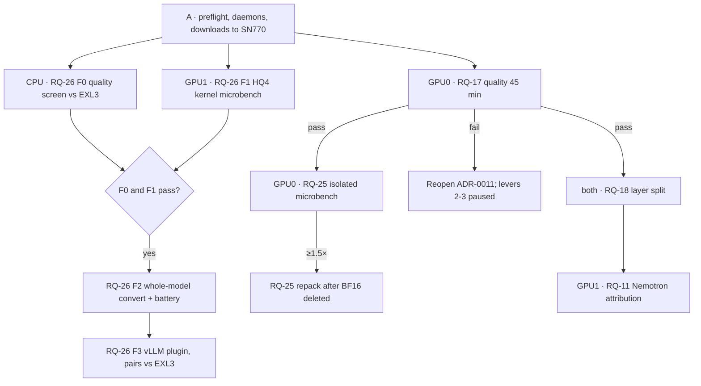

# B70 next program — speed track

Only levers never tried on this host are listed. Gates are in
`registry/research-program.json`; ledger rows are RL-127 to RL-130. No step adopts a
route by itself (AGENTS.md §12). The workflow prompt is
`docs/plans/2026-10-09-zcode-workflow-prompt.md`.

## 1. What the B70 rewards

| Observed fact | What it implies |
|---|---|
| Decode = bytes ÷ achieved bandwidth. Measured kernels reach only 20–63 % of 608 GB/s. | The ALU and load cost of unpacking each weight matters as much as bit-width |
| EXL3's 381 GB/s is limited by trellis decode (RL-119). Rotation alone fixes most INT4 error (RL-067). | A cheap code plus Hadamard incoherence could get EXL3 quality at INT4 decode cost → **HQ4** |
| Reading experts from host RAM is ~50× slower than from VRAM | Keep experts resident → RQ-18 |
| Misaligned block loads split on Xe2. Strata saw 2.3–4.7× from aligning Q6_K. | IQ3_XXS was never aligned → RQ-25 |
| INT8 DPAS runs at 2× FP16. There is no FP4/FP8 math. | Prefill gains need integer activations → RQ-22 |

## 2. Levers (all new here)

| # | Lever | Kind | Route | Priced | Question |
|---:|---|---|---|---|---|
| 1 | **HQ4 format**: block-128 sign+Hadamard + affine INT4 G128 in a DPAS layout, replacing the EXL3 trellis | **New quant format** | Dense 27B | 1.27× decode (ceiling 1.60×) | RQ-26 (+ RQ-20 kernel half) |
| 2 | Aligned structure-of-arrays IQ3_XXS layout | Layout + kernel | Flash-Next / Strata | 1.24× (ceiling 1.61×) | RQ-25 |
| 3 | Two-card layer split, every expert resident | Placement | Flash-Next / Strata | ≤1.53× | RQ-18 |
| 4 | Nemotron round attribution, then INT4 grouped expert GEMM | Kernel | Nemotron | after profile | RQ-11 |
| 5 | INT8 prompt GEMM | Kernel (prefill) | Flash-Next / Strata | price first | RQ-22 |

Removed as not new:
- **RQ-24 (INT4 Nemotron drafter):** already priced at +7–11 % in the Nemotron dossier (closed, RL-130).
- **MXFP4 (RQ-19):** closed, RL-128.

The gate that comes first: **RQ-17**, the quality check on the Flash-Next route. Levers 2 and 3 only matter if that route is correct.

## 3. Order

## 4. Storage (SN770 160 GB free)

| Item | Size | When |
|---|---:|---|
| Qwen3.8-27B BF16 source | 55.6 GB | Phase A |
| EXL3 4bpw @113cf7ab | 16.9 GB | Phase A (also restores the dense route) |
| HQ4 artifact | ~14 GB | F2 |
| RQ-25 repacked IQ3_XXS | ~76 GB | Only after the BF16 source is deleted |

## 5. Time

| Phase | GPU | Time |
|---|---|---|
| A preflight + downloads | none | 1 h + download time |
| RQ-17 | GPU0 | 45 min |
| RQ-26 F0 | none | 4–8 h CPU (hidden-state regeneration dominates) |
| RQ-26 F1 | GPU1 | 3 h code + 1 h GPU |
| RQ-25 isolated | GPU0 | 2 h code + 1 h GPU |
| RQ-18 | both | 2 h |
| RQ-26 F2 / F3 | one card | a later session each |
