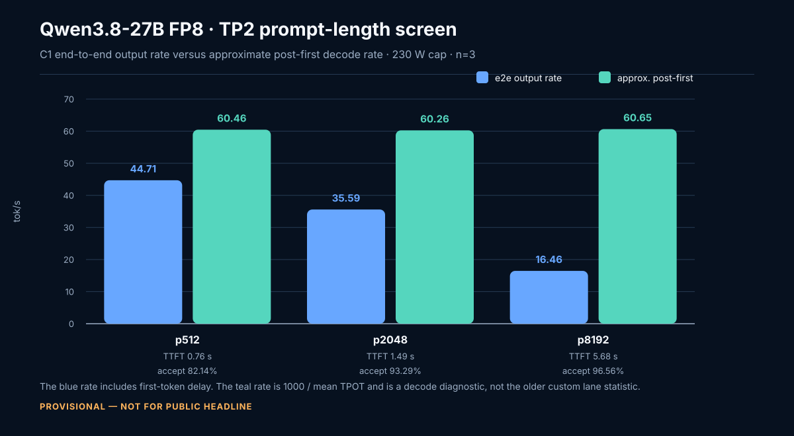
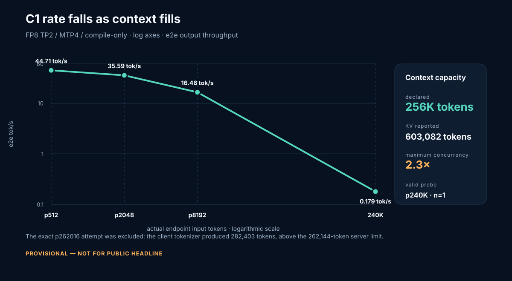
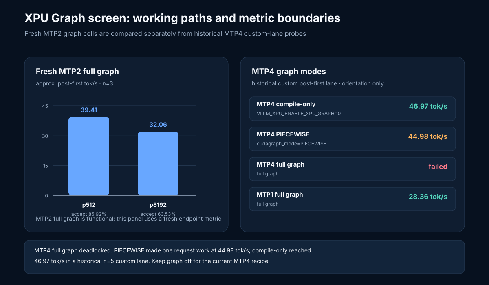
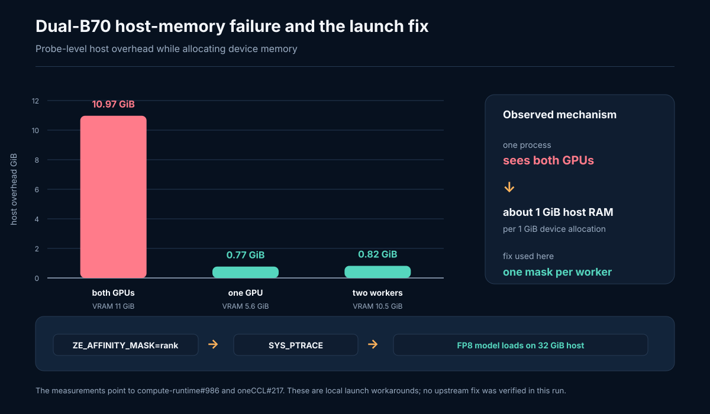

---
schema_version: 1
model_id: Qwen/Qwen3.8-27B
model_slug: qwen3.8-27b
document: serving
as_of: 2026-08-30
status: validated_internal
truth_verdict: PARTIAL
evidence_tier: E2
engine: vllm-xpu
primary_evidence:
  - ../../../results/2026/08/qw38-fp8-tp2-mtp4-230w-compile-confirm-20260828T130000Z/
  - ../../../results/2026/08/qw38-fp8-tp2-n5-final-20260830T174732Z/
  - ../../../results/2026/08/qw38-fp8-tp2-mtp4-230w-fullctx-20260828T130957Z/
  - ../../../results/2026/08/qw38-fp8-tp2-mtp2-graph-confirm-20260828T114155Z/
  - ../../../results/2026/08/vllm-qwen38-4mode-230w-20260815T170840Z-581426/summary.json
  - ../../../archive/legacy-docs-20260915/benchmark-history.md
  - ../../../research/2026/qwen38-dflash2-smoke-20260819.md
---

# Serving

## Route state 2026-09-25 — single-card decode measured at its byte floor

**Scope (2026-10-07):** this section and the draft-side INT4 recipe below describe the
**removed GPTQ/W4A16 champion route** (artifact removed 2026-09-27, ADR-0010). Its floor
closures bind that route's implementation only. The current route is EXL3
(`../../../engines/exl3xpu/README.md`), and there the single-card kernel question is
**OPEN and ranked first** (`research/PROGRAM.md` RQ-01…RQ-04): the M=4 verify pass is
instruction-issue bound (RL-119), not at a proven byte floor.

The improvement night of 2026-09-25 ([night report](../../../docs/plans/2026-09-20-b70-improvement-roadmap/worklogs/NIGHT-REPORT-20260925.md); ledger RL-061…RL-065) closed the single-card lever hunt with **zero promotions**: the recipe below is unchanged and is now **measured at its byte-budget floor**. The 44.8 ms C1 decode round decomposes as: host control-basis prep ≈4.8 ms (screen-proven mostly overlapped — halving it bought +1.51 %), four draft passes ≈5.5 ms (the unavoidable 4×-read bytes floor — post-pair budget 3.498 GB/round incl. scales; "stream at pin rate" is model arithmetic, no DRAM-counter measurement exists, corrected 2026-09-29 — and cannot be cached on-chip), the unquantized full-vocabulary head ≈4.2–4.7 ms (at its bytes floor), body W4A16 verify ≈28–30 ms wall-clock (in-graph composition untraced; bytes floor ≈25–28 ms), misc ≈2 ms.

Closed on measurement (do not rebuild): host-prep caching, draft-fusion and exact-head kernels (at floor), vLLM #56096 (dispatch exists only for `qwen3_next`/CUDA; this route is `qwen3_5`), the `max-num-batched-tokens` TTFT sweep (±0.25 %) — plus every earlier closure (D11/D12/D14, verify-head quantization, k≠4, DFlash2, kernels 0.1.15.4).

**Next to verify, in order:**
1. **Copy-based collective correctness** on the verified direct-peer path (RL-059: bidirectional ~11.1–11.9 GB/s checksum-clean; ATOMICS absent ⇒ copy-based sync only) → if clean, a gated TP2 research campaign vs a matched one-card control behind ADR-0008. Honest modeled band **~1.4–1.6× decode**.
2. **Unitrace capture of one graph-captured round** — record-closing for the 63–67 % body bucket; expected slack ≤2–4 ms; a formality, not a lever.
3. **Thermal window (operator)** — the ≤55 °C protocol gate is unreachable while a server is loaded (RL-065); until chassis/ambient intervention or an accepted substitution rule, measured deltas are diagnostic-grade. The night's own numbers used matched-arm thermal substitution (±1 °C, counterbalanced) and are not public evidence.

## Draft-side INT4 — the biggest measured decode lever on this route (2026-09-21, publication-grade re-measure 2026-09-22)

PROVISIONAL — NOT FOR PUBLIC HEADLINE. Quantizing **only the draft's own weights** (its MTP LM head
and its MTP body) to W4A16 GPTQ-style INT4 g128 while the target stays GPTQ-INT4 G128 + BF16 draft
head raised decode throughput by **+37 % to +48.6 %** across six independent ABBA runs on the
champion stack (digest `f01e24f6…` + stack overlay, XPU graph capture on, recommended non-thinking
sampling):

| cell | baseline | draft-side INT4 | n | class |
|---|---:|---:|---:|---|
| C1 p8192/g128, calibrated 8,194 tokens (publication-grade, energy telemetry) | 48.81 tok/s post-first | **72.55 (+48.6 %)** | 5+5 | fresh |
| C1 p512/g128, calibrated 517 tokens (publication-grade, energy telemetry) | 52.61 | **73.43 (+39.6 %)** | 5+5 | fresh |
| C1 p8192/g128, calibrated (8,189 of 8,192 tokens) | 55.61 tok/s post-first | **80.32 (+44.4 %)** | 5 | earlier |
| C1 p8192/g128 (first measurement), actual 6993 endpoint tokens (uncalibrated) | 52.99 | **72.68 (+37.2 %)** | 5 | earlier |
| C1 p512/g128, actual 447 endpoint tokens (word-count client, uncalibrated — n=3 screen only) | 52.83 | **77.14 (+46.0 %)** | 3 | earlier |
| C1 p8192/g128, both arms patched (repeatability control) | 80.61 / 78.27 | — | 5+5 | control |

- **Enabler:** XPU graph capture. With `VLLM_XPU_ENABLE_XPU_GRAPH=0` the same two patches measure
  ≤1.5 % — host overhead hides the weight traffic. Capture itself is ~1.68× at this cell.
- **Iso-power efficiency (new 2026-09-22, measured energy):** both arms draw the same — 228.74 vs
  229.49 W at p8192, 224.53 vs 228.59 W at p512 (230 W configured cap, xe `energy1_input` counter
  delta over the measured window) — while the patched arm does more work, so measured tokens/J
  improves **+9.6 % at p8192** (0.0596 → 0.0654) and **+31.4 % at p512** (0.1952 → 0.2566). The
  energy window includes prefill of 5 requests per arm (not decode-only); reads bracket only the
  measured window.
- **Output preservation:** greedy output is byte-identical to the un-quantized draft (three prompts ×
  two repeats, same sha256, deterministic within arm); six open-ended prompts × 30 seeded draws per
  arm give the **same modal emitted class on every prompt**. The accept *rate* varies run-to-run in
  the patched configuration (0.55–0.70 vs the baseline's 0.4873–0.58) while throughput does not —
  drafting-efficiency variance, documented rather than chased. **Acceptance is content-dependent and bimodal (2026-09-29 finding):** per-position survivals run 0.98/0.98/0.12/0.09 on the D11 natural-text window vs ~1.00/0.96/0.88/0.88 on a p512 window — never treat α or the survival profile as a stable head property. α economics: **+6.25 % per +0.05** (counter form 1+4α), not the previously-quoted +8.3…8.8 %. Patched medians span 72.55–80.32 with
  within-run samples 64.25–91.17: read the median band, not a point.
- **Validity limits:** C1/TP1 only (with TP>1 the target no longer protects the emitted sequence on
  every path, so the implementation fails closed); the patches are **local** (cookbook
  `patches/patch_draft_lmhead_int4.py`, `patch_draft_mtp_int4.py`), env-gated
  (`B70_DRAFT_LMHEAD_INT4=1`, `B70_DRAFT_MTP_INT4=1`), and now also exist as a reviewable vLLM tree
  change in `~/vllm-src/vllm` (`VLLM_DRAFT_INT4=1`) — see
  `research/2026/qwen38-draft-side-int4-upstream-20260921.md`.
- **Correctness hazard to disclose with any reproduction:** upstream vLLM **#54785** (2026-09-01,
  `intel-gpu`) reports XPU graph capture with MTP `num_speculative_tokens=4` can produce
  non-deterministic wrong logits at `temperature=0` (k≤3 reported clean), and tonight's research
  confirmed it implicates exactly this champion stack at k=4 with no fix merged. Both arms ran
  capture-on so the A/B is internally consistent; anyone reproducing must validate greedy determinism
  for their own case. The upstream k=3 clamp was measured 2026-09-23 and **not adopted**: it costs **+5.45 % decode** (k4 75.04 vs k3 71.16 tok/s, n=5/arm) and the spec-canary shows the corruption is not live at k=4 on this stack (8/8 identical greedy outputs both depths). Keep MTP4.
- **Publication state:** the claims-audit fix list is CLOSED (metric naming, patch-generation
  provenance `research/2026/qwen38-draft-int4-patch-provenance-20260922.md`, energy/temp telemetry
  in all four arms, anchor validation `worklogs/P4-anchor-validation-20260922.md`) and an independent
  wording audit passed (0 blockers). Four **LocalMaxxing** self-report records are published
  (APPROVED 2026-09-22, canonical run ids `cmud9viep0avulq01364r8cyo` (72.55), `cmud9wwv10avxlq01saixkle6` (48.81), `cmud9ybo00aw0lq01ql01bhqn` (73.43), `cmud9zqjp0aw3lq0160e0i44v` (52.61) — a pre-fix duplicate set (`cmud9n4fp0…` family) also live, no delete path — see  `research/2026/localmaxxing-platform-20260922.md`). Remaining before a **public headline**: the
  tree-patch wiring validation and Sergio's own call. Evidence:
  `results/2026/09/b70-improvement-probes-20260920/p4-champion-ab-*`.

**Cookbook publication 2026-09-26 (operator-authorized):** the publication-grade A/B pair is now in the
public cookbook catalog — `qwen38-27-draft-int4-p512-g128-c1` corrected to the calibrated cell (73.4
median, recommended sampling, cache off) and new `qwen38-27-draft-int4-p8192-g128-c1` (72.55, +48.6 %),
plus a flash-next AP-Q4_K_XL dual-card placement capability record. Evidence doc
`cookbook/docs/qwen38-27b/DRAFT-INT4-S-M1.md` @ cookbook commit 997ca50f…; catalog 28 records; renderer/tests
green; pushed (8827183). XeCores fallback sync (`npm run sync:cookbook`) still owed before its next deploy.


**Serving throughput (aggregate, not single-stream):** the same server scales ~2.4× by B=4 and
2.79× by B=32 (patched config 61.86 → 140.30 at B=4 → 172.48 tok/s at B=32), with per-request rate
falling 72 → ~29 tok/s and TTFT rising from ~0.35 s to ~2 s. Aggregate numbers are **never**
comparable to the single-stream records below.

## Base vLLM class

The Run 40 matrix used vLLM `0.27.2rc1.dev77+gac7509e2b`, XPU kernels 0.1.12.3, GPTQ INT4 G128 target, BF16 MTP head, fp8 KV, graphs on, cache off, U=0.88, scheduler budget 8,192, and a configured 230 W cap. Client post-first medians at p512/g128 were 32.9 no-spec, 52.0 MTP1, 65.8 MTP2, and 83.7 tok/s MTP4. Exact 131,072 total tokens completed once at 56.3 tok/s under MTP4.

## Sampling regimes

| Regime | Settings | C1 p512/g128 median | Label |
|---|---|---:|---|
| Greedy diagnostic | temperature 0; diagnostic client | 106.7 tok/s | Run 47 diagnostic |
| Recommended non-thinking | temperature 0.7, top_p 0.80, top_k 20, presence penalty 1.5, thinking off | 102.61 tok/s | Run 48 n=5 |
| Recommended thinking | temperature 1.0, top_p 0.95, top_k 20, presence penalty 0, thinking on; reasoning effort selected separately | 99.32 tok/s | Run 48 n=5 |

These Run 47/48 figures use a later prefix-on champion stack and must not be blended with the cache-off Run 40 matrix. Under recommended non-thinking sampling, C5 aggregate throughput was 107.8 tok/s, or 21.6 tok/s per user; C1 and C5 are different workloads.

## Dual-card

The default dual-B70 policy remains independent stacks ([ADR-0008](../../../decisions/adr-0008-dual-b70-independent-default.md)). The native FP8 artifact is the exception: it needs both cards in one TP2 server.

**Update 2026-09-25:** direct-peer capability is now verified locally (RL-059 — bidirectional checksum-clean copies at ~11.1–11.9 GB/s, 2.02× host-staged; **ATOMICS absent**, so collectives must use copy-based synchronization). This does not change the default: any TP2 work stays behind ADR-0008 and a collective-correctness gate (O14), with an honest modeled decode band of ~1.4–1.6× vs one card. See "Route state" above.

An external vLLM TP2 recipe for a different AutoRound INT4 checkpoint is captured in [`research/2026/humble-b70-llm-dual-tp2-20260824.md`](../../../research/2026/humble-b70-llm-dual-tp2-20260824.md). Their cold TP1 66.84 / TP2 94.58 and warm LMX TP1 97.8 / TP2 136.4 are **not comparable** to Run 48 (different checkpoint, converter, MTP depth, KV, prefix cache, statistic, and card count). Do not publish those rows as this host.

## Research exclusions

DFlash2's n=5 screen used actual p476/g128, cache off, eager execution, and a wrong causal fallback mask. Its 22.41 tok/s and 24.7% acceptance are coherent-output research observations, not a serving recipe or a comparison to MTP4.

## Official DFlash2 objective campaign — 2026-08-30 (adoption-first)

PROVISIONAL — NOT FOR PUBLIC HEADLINE. The official `incoai/Qwen3.8-27B-DFlash2` checkpoint
(2B BF16, block size 8 = 7 draft tokens/step) plus merged upstream [vLLM PR #52816](https://github.com/vllm-project/vllm/pull/52816)
(`DFlash2DraftModel` + `DFlash2Speculator`, `method=dflash`, head `19c9351904…`) change the
speculative route plan: adoption of the official checkpoint precedes any retraining. The
published Qwen3.8-27B mean acceptance length is **4.80 vs native MTP 4.28 vs community DSpark
3.62 at block size 8** and 2.7–3.4× vs autoregressive on one NVIDIA H200/BF16/FA3 — external
evidence (E3), not B70 projections, and not evidence for the earlier length 8–10 projection.

Reconciliation for this host: the 2026-08-19 24.7% n=5 result was an implementation failure
(off-by-one proposer offsets; masked by the wrong causal fallback mask), and the 2026-08-29
90.5% p2048 cell was a narrow corrected-stack observation (rmacy image, community DSpark
drafter) — neither is a representative official-DFlash2 number, and the rmacy stack cannot take
the custom-kernel work. The 2026-08-19 blocker (fp16 draft-MLP NaN) is structurally addressed by
this campaign's BF16 FP8 stack; non-causal draft attention on XPU remains the primary open gate.

Decision authority: [`research/2026/qwen38-dflash2-objective-campaign-20260830.md`](../../../research/2026/qwen38-dflash2-objective-campaign-20260830.md);
campaign record: [`campaigns/2026/qwen38-dflash2-objective/README.md`](../../../campaigns/2026/qwen38-dflash2-objective/README.md);
registry: `CAM-2026-QWEN38-DFLASH2-OBJECTIVE`. Lane: C1, TP2, official FP8 target,
W8A16/small-M verifier stack, DFlash2 k=7 vs matched native MTP7 (p512/g128 + p1024/g128),
MTP8 incumbent as operational reference, p2048/g128 as a stability diagnostic. Until a gate
passes, keep MTP4 / the k=8 record as serving spec.

**Outcome 2026-08-30: completed no-go.** Official DFlash2 k=7 passed correctness (5/5
coherent-prefix parity) but lost the matched n=3 screen on every cell (e2e 11.12 vs MTP7 22.14
tok/s at p512; acceptance 0.10–0.12 vs 0.35–0.41; mean accept length ≈0.7 vs ≈2.8). Leading
mechanism: FP8 target-state mismatch against the BF16-trained draft. DFlash2 adoption on the FP8
W8A16 TP2 stack is closed; MTP4 / the k=8 record remain the serving spec. Full gates and loss
decomposition in the research authority §11.

**DSpark follow-up (2026-08-30): drafter acceptance does not transfer to this stack.** The
FP8-trained community DSpark drafter (Doopeworld/Qwen3.8-27B-DSpark-vLLM — RadixArk weights,
native `Qwen3DSparkModel` on the pinned image) passed correctness but measured ≈2% acceptance
(mean len ≈0.15) in both block layouts, and identically ≈1.5–1.9% against the INT4 GPTQ target
(author's served setup) — refuting both the layout and the FP8-W8A16 target-state hypotheses.
Remaining suspect: the vLLM 0.27.2 DSpark serving contract vs the author's 0.26.1 (first-cycle
trace vs the SpecForge reference is the named next step; probabilistic drafting additionally
crashes this build's worker init — `hf_overrides must be a dict`). Even a recovered drafter is
bounded at ≈35–60 tok/s by the architect's cycle analysis; the 80+ FP8 target needs draft-side
cycle-time kernels, not acceptance recovery. Details: campaign decision log A5/A6.


## Official FP8 artifact route — 2026-08-27/28

PROVISIONAL — NOT FOR PUBLIC HEADLINE. `Qwen/Qwen3.8-27B-FP8` selects the native
`XPUFp8BlockScaledMMKernel`. The 30,890,081,596-byte artifact is about 28.75 GiB, so there is
no useful FP8 TP1 serving route on one 32 GiB B70. The supported speed topology here is TP2;
PP2 is recorded separately as a validation topology.

### TP2 — tensor-parallel speed route

The recipe of record uses the pinned image `vllm/vllm-openai-xpu@sha256:f01e24f6c7ff01f1e0662234255a1372297d1dbd89d003cf13c8fad3eab1ba4f`,
the native artifact at `/mnt/<models-disk>/hf/qw38-fp8`, TP2/PP1, MTP4, BF16 compute, FP8 KV,
prefix cache off, compile-only execution, and a declared 230 W research cap:

```text
--tensor-parallel-size 2 --pipeline-parallel-size 1
--quantization fp8 --dtype bfloat16 --kv-cache-dtype fp8
--speculative-config '{"method":"mtp","num_speculative_tokens":4}'
--max-model-len 9216 --max-num-seqs 8 --max-num-batched-tokens 4096
--gpu-memory-utilization 0.90 --no-enable-prefix-caching --language-model-only
VLLM_XPU_ENABLE_XPU_GRAPH=0
```

The launch also needs the local spawn-time affinity patch
(`scripts/tmp/patch_vllm_worker_affinity.py`) and Docker `--cap-add SYS_PTRACE`, as wired by
`scripts/tmp/qw38-fp8-pp2-affinity-launch.sh` (`../../../scripts/tmp/qw38-fp8-pp2-affinity-launch.sh`).
The container starts with `ZE_AFFINITY_MASK=0,1`; the patch changes each spawned worker to its
own rank mask before Level Zero initializes.

The root-cause probe found that one process seeing both GPUs pays about 1 GiB host RAM per GiB
of device allocation ([intel/compute-runtime#986](https://github.com/intel/compute-runtime/issues/986)).
Per-worker masks reduced the measured host overhead to about 0.8 GiB in the isolated probe.
`SYS_PTRACE` fixes the separate oneCCL pidfd/seccomp deadlock
([uxlfoundation/oneCCL#217](https://github.com/uxlfoundation/oneCCL/issues/217)). These are local
workarounds; the upstream issues are still open. The route loads and serves on 32 GiB host RAM,
but a fresh high-batch compile can still push cold pages into swap.

Fresh C1 measurements used 230 W, cache off, exact endpoint input lengths, one same-shape
warmup, and n=3 measured requests. Output throughput includes time to first token. The
post-first column is only the approximation `1000 / mean TPOT`; it is not the older custom lane
statistic.

| Cell | Output throughput | Mean TTFT | Mean TPOT | Approx. post-first | Acceptance | Result |
|---|---:|---:|---:|---:|---:|---|
| p512/g128 | 44.71 tok/s | 762.38 ms | 16.539 ms | 60.46 tok/s | 82.14% | 3/3 |
| p2048/g128 | 35.59 tok/s | 1,489.11 ms | 16.595 ms | 60.26 tok/s | 93.29% | 3/3 |
| p8192/g128 | 16.46 tok/s | 5,681.05 ms | 16.489 ms | 60.65 tok/s | 96.56% | 3/3 |

Evidence: `results/2026/08/qw38-fp8-tp2-mtp4-230w-compile-confirm-20260828T130000Z/`.

#### LocalMaxxing speed-test payloads — 2026-08-30

PROVISIONAL — NOT FOR PUBLIC HEADLINE. `lmx speed-test run vllm --mode remote` against
the official FP8 TP2 stack (pinned image, per-worker affinity, 230 W declared, concurrency 1,
platform default 74-token prompt, `--max-tokens 256`, warmup 1, iterations 3). Payloads are
**validate-local only — not submitted** (submission requires separate authorization).

| Route | tokSOut (tok/s) | tokSPrefill (tok/s) | TTFT (ms) | Evidence |
|---|---:|---:|---:|---|
| FP8 TP2 MTP8, eager, no wheel | 18.5 | 375.2 | 197.2 | `results/qwen38-lmx-fp8-tp2-mtp8-20260830T*Z/` |
| FP8 TP2 MTP8, compile, no wheel | **30.0** | **502.5** | **147.3** | `results/2026/08/qwen38-lmx-fp8-tp2-mtp8-compile-20260830T121838Z/` |

Reading: the compile route (route of record) beats eager by ~1.6× at the platform's short
prompt; the 74-token default prompt is a different content draw than the p512/g128 record
cells, so these payloads are comparable to other LocalMaxxing runs, not to the dossier's
internal tables. Hardware payload: `gpuCount 2, vramGb 64, powerWatts 230, Arc Pro B70`.

**Final serialized submission (2026-08-30):** LocalMaxxing id
`cmtg4erjj001xqr01jhqw81dt` is `APPROVED` at **31.1 tok/s median client post-first output**
and 189.93 ms median TTFT, p74/g256, C1, n=3. The payload used server-default temperature
1.0 because its schema had no temperature field. `APPROVED` means accepted self-reported
submission, not independent reproduction. The earlier contended 28.6 tok/s row is superseded.
Evidence: `results/2026/08/qw38-fp8-tp2-n5-final-20260830T174732Z/platform/` and public sanitized
receipt at cookbook commit `2c6de11d7f19659b746ed00fc4c6229136d9874b`.

#### FP8 TP2 MTP8 final n=5 sampling sensitivity — 2026-08-30

The public cookbook now separates greedy synthetic maxima from model-card-sampling diagnostics.
All cells are C1, random-token synthetic prompts, g128 completed on all five measured requests,
one same-shape warmup discarded, cache disabled, 230 W configured caps, and energy-counter draw
measured over each cell interval.

| Sampling / cell | Median / max client e2e output | Mean TPOT | Median TTFT | Mean accepted length | Measured draw GPU0/GPU1 |
|---|---:|---:|---:|---:|---:|
| Greedy k8 p512/g128 | 53.42 / 63.70 tok/s | 16.78 ms | 424.30 ms | 5.268 | 97.6 / 103.6 W |
| Greedy k8 p1024/g128 | 60.13 / 71.06 tok/s | 14.15 ms | 589.78 ms | 5.750 | 109.5 / 118.9 W |
| Model-card non-thinking p512/g128 | 22.16 / 36.80 tok/s | 42.40 ms | 389.83 ms | 1.979 | 99.3 / 111.3 W |
| Model-card non-thinking p1024/g128 | 11.66 / 28.21 tok/s | 71.92 ms | 571.70 ms | 1.140 | 128.8 / 154.2 W |

Model-card non-thinking means temperature 0.7, top_p 0.8, top_k 20, presence penalty 1.5.
Because prompt content remained random-token synthetic, these are sampling-sensitivity diagnostics,
not natural-content performance or task-quality evaluations. The k-depth-versus-numerics cause of
the acceptance collapse remains open. The separate Pi quality phase was stopped and voided; no
completed quality comparison is claimed. Evidence authority:
`results/2026/08/qw38-fp8-tp2-n5-final-20260830T174732Z/RESULTS_SECURED.md`; reconciled public catalog
commit `7025ef443969bd5123169e7d34f18b89ef77becd`. Generic topology authority is
`research/2026/humble-b70-llm-dual-tp2-20260824.md`; model-specific stack authority is `research/2026/qw38-fp8-singlecard-unblock-and-pp2-rootcause-20260827.md`.



The numeric source for this table and the companion figures is `assets/qwen38-b70-fp8.json`.

#### Full-context check

The model metadata declares a 262,144-token context. With `max_model_len=262144`, the server
reported 603,082 KV tokens and `2.30×` maximum concurrency at the full request length. A valid
near-maximum request used p240000/g128, n=1:

| Cell | Output throughput | Mean TTFT | Mean TPOT | Acceptance | Result |
|---|---:|---:|---:|---:|---|
| p240000/g128 | 0.179 tok/s | 711.06 s | 25.681 ms | 80.42% | 1/1 |

The exact p262016 attempt was excluded because the client tokenizer produced 282,403 tokens,
above the 262,144-token server limit. Evidence: `results/2026/08/qw38-fp8-tp2-mtp4-230w-fullctx-20260828T130957Z/`.



#### XPU Graph screen

MTP1 and MTP2 full graph capture work on TP2 with the per-worker masks. Fresh MTP2 full-graph
confirmation was slower than the MTP4 compile-only route:

| Cell | Output throughput | Mean TPOT | Approx. post-first | Acceptance | Result |
|---|---:|---:|---:|---:|---|
| MTP2, p512/g128 | 34.39 tok/s | 25.37 ms | 39.41 tok/s | 85.92% | 3/3 |
| MTP2, p8192/g128 | 11.30 tok/s | 31.19 ms | 32.06 tok/s | 63.53% | 3/3 |

MTP4 full graph capture failed in earlier TP2 runs. The PIECEWISE setting
(`--compilation-config '{"cudagraph_mode":"PIECEWISE"}'`) made one MTP4 p512 request work at
44.98 tok/s, but the historical compile-only result was faster at 46.97 tok/s. The current
speed recipe therefore keeps `VLLM_XPU_ENABLE_XPU_GRAPH=0`.

Evidence: `results/2026/08/qw38-fp8-tp2-mtp2-graph-confirm-20260828T114155Z/`,
`results/2026/08/qw38-fp8-tp2-mtp4-pwgraph-20260828/`, and
`results/2026/08/qw38-fp8-tp2-mtp4-compile-x570-20260828/`.



#### Cn result at the KV-safe limit

At `max_model_len=9216`, the server reported 132,096 KV tokens, or `14.33×` full-context
concurrency. A C14 MTP4 wave was therefore attempted. It was excluded: when fresh prefills and
MTP4 decode work overlapped, both TP workers raised:

```text
RuntimeError: causal_conv1d does not support spec-decode and non-spec
(prefill + decode) tokens in the same invocation
```

The same failure occurred in the earlier C19 attempt. The C14 run was not a throughput result;
it did not OOM (`exit=0`, `OOMKilled=false`). Evidence:
`results/2026/08/qw38-fp8-tp2-mtp4-230w-c14-20260828T141323Z/` and
`results/2026/08/qw38-fp8-tp2-mtp4-230w-concurrency-wave-20260828T135602Z/`.

Two no-spec C14 controls were excluded before health. The compile route drove `MemAvailable` to
1,029 MiB, and the eager route reached 1,008 MiB; both were stopped by the 3,072 MiB watchdog
floor. Neither produced a throughput result. Evidence:
`results/2026/08/qw38-fp8-tp2-nospec-230w-c14-20260828T141700Z/` and
`results/2026/08/qw38-fp8-tp2-nospec-eager-c14-20260828T142000Z/`. Do not publish a Cn throughput number
for this build until the GDN mixed prefill/decode path and the host-memory load envelope are fixed.

### PP2 — pipeline-parallel validation topology

PP2 uses `--tensor-parallel-size 1 --pipeline-parallel-size 2`. It proved that the official FP8
artifact can load and produce coherent output across both cards, but it is not the speed route.
These are historical n=5/custom-lane validation observations from the B450-F topology and must
not be blended with the fresh TP2 n=3 table:

| PP2 mode | C1 decode | Cold input | Status |
|---|---:|---:|---|
| eager | 8.05 tok/s | 1,077 tok/s | validation only |
| compile | 10.9 tok/s | 639 tok/s | validation only; graph capture had no speed effect |

PP2 used the same per-worker affinity patch and `SYS_PTRACE`; the serial materialization overlay
was used only for the PP2 load path. Evidence: `results/2026/08/qw38-fp8-pp2-bench-20260827/`,
`results/2026/08/qw38-fp8-pp2-graphs-20260827/`, `results/2026/08/qw38-fp8-pp2-xpugraph-20260827/`, and
`results/2026/08/qw38-fp8-pp2-affval5-20260827/`.

### Patch ledger

| Item | State | Scope | Reason |
|---|---|---|---|
| `patch_vllm_worker_affinity.py` | required local workaround | TP2 and PP2 | Sets one Level Zero device mask per spawned worker before device initialization. |
| Docker `--cap-add SYS_PTRACE` | required launch setting | TP2 and PP2 | Keeps oneCCL on its pidfd IPC path under Docker seccomp. |
| `cudagraph_mode=PIECEWISE` | functional graph workaround | MTP4 graph test | Avoids the first-generation full-graph failure; slower than compile-only. |
| `VLLM_XPU_ENABLE_XPU_GRAPH=0` | speed configuration | TP2 MTP4 | Current fastest functional MTP4 route. |
| Two's-complement pointer wrap in `mamba_utils` | rejected | INT4 | Prevented the VA overflow but produced garbage tokens; not a fix. |



## INT4 comparison — separate artifact and topology

FP8 TP1 is not included because the official FP8 artifact leaves no useful single-card serving
headroom. Current INT4 TP2 at 230 W used the current no-g_idx artifact, FP8 KV, full graphs, and
n=3 measured requests:

| Cell | Output throughput | Mean TPOT | Acceptance | Result |
|---|---:|---:|---:|---|
| TP2 p512/g128 | 84.00 tok/s | 9.199 ms | 69.12% | 3/3 |
| TP2 p2048/g128 | 38.35 tok/s | 18.473 ms | 24.49% | 3/3 |
| TP2 p8192/g128 | 24.52 tok/s | 9.587 ms | 74.23% | 3/3 |

Evidence: `results/2026/08/qw38-int4-tp2-mtp4-230w-graph-confirm-20260828T120423Z/`.

The current one-card INT4 control at 150 W measured 49.08 tok/s at p512/g128 and 12.51 tok/s
at p8192/g128, both n=3. The older 230 W 83.7/77.1 figures used a different artifact and
custom post-first statistic, so they are historical orientation only.

Evidence: `results/2026/08/qw38-int4-sc-mtp4-champ-20260828T112032Z/` and
`results/2026/08/vllm-qwen38-4mode-230w-20260815T170840Z-581426/`.

### X draft — hold for claims audit

Dual Arc Pro B70s can run the official Qwen3.8-27B FP8 artifact on a 32 GiB host after two local
launch fixes: one Level Zero device mask per TP worker, plus Docker `SYS_PTRACE` for oneCCL IPC.

Fresh TP2/MTP4/compile-only results at 230 W, n=3: 44.71 tok/s at p512, 35.59 at p2048, and
16.46 at p8192. The valid near-maximum p240K probe sustained 0.179 tok/s with 25.68 ms decode
steps. MTP4 Cn is not publishable yet: mixed prefill/decode requests crash the current GDN path.

Status: PROVISIONAL — NOT FOR PUBLIC HEADLINE.

## Dual-B70 layer-split (llama.cpp SYCL) — 2026-08-24

PROVISIONAL. Q4_K_M GGUF (verified `7b2aec3b…`), build 1692f9e50, KV q8_0/q4_1, fa on,
230 W declared. `-sm layer -ts 1/1 -mg 0` with `ZE_AFFINITY_MASK=0,1`:

- decode tg128 n=5: 26.03 ± 0.01 t/s vs single-GPU0 25.78 ± 0.01 (+1.0 %)
- real workload g256 HTTP engine median: 25.58 vs 25.31 t/s (+1.1 %)
- long cold prefill ~8260 tok: −1.7 % vs control; pp512 −2.7 %; pp8192 +1.3 %
- row split (`-sm row`): SIGSEGV — closed as negative diagnostic
- Greedy replay may diverge by one token (SYCL reduction ordering); coherence unaffected

Interpretation: layer-split buys capacity (65 GiB combined) at decode parity-to-slight-win;
the x4 second-slot link is not observable at C1 decode. Evidence:
`results/2026/08/qw38-dualcard-20260824T123000Z/`; analysis:
`research/2026/dual-b70-stack-research-20260824.md`.

## 2026-08-28 evening campaign — content-driven acceptance, image A/B, graphs closure, power answer

PROVISIONAL — NOT FOR PUBLIC HEADLINE. All cells on this host (ASUS ROG STRIX X570-F GAMING since 2026-08-27, dual CPU-attached x8/x8, `0000:0b:00.0` + `0000:0f:00.0`),
TP2/PP1, `max_model_len 9216`, `max_num_seqs 8`, `max_num_batched_tokens 4096`, MTP4, KV fp8,
prefix cache off, compile-only, declared 230 W caps, n=3 measured after one same-shape warmup,
per-request output = 128 / mean e2el. Bench: `vllm bench serve` random dataset; the seed
determines prompt content, and **MTP acceptance on this model is strongly content-driven**, so
every MTP row below must be read with its content column.

### The headline finding — acceptance is content, not configuration

Same host, same pinned image, same recipe flags, MTP4, p512/g128:

| Content draw | Output tok/s | Mean TPOT | Mean TTFT | Acceptance | Run |
|---|---:|---:|---:|---:|---|
| random (harness auto seed) | 44.71 | 16.54 ms | 762 ms | 82.1 % | `...compile-confirm-20260828T130000Z` |
| random, seed 240852 | 27.12 | 33.02 ms | 527 ms | 36.7 % | `...forcepcie-20260828T23*` |
| random, seed 240852 + compilation-config PIECEWISE | 27.41 | 32.5 ms | 538 ms | 37.2 % | `...pwgraph-20260828T223900Z` |

Step time is nearly constant (~59–71 ms/step); what changes is accepted tokens per step
(≈4.3 vs ≈1.8). A single MTP number without its content draw is not publishable. On
unfavorable content, FP8 MTP4 **loses** to no-spec (27.1 vs 29.0 tok/s, bat3). Do not
headline any MTP cell without quoting acceptance and content provenance.

### Nightly image A/B — matched content (seed 240852), FP8 MTP4, 230 W

| Image | vLLM / kernels | p512 tok/s | TPOT | TTFT | Acceptance | p8192 tok/s |
|---|---|---:|---:|---:|---:|---:|
| pinned `f01e24f6` | 0.27.2rc1.dev77 / 0.1.12.3 | 27.12 | 33.0 ms | 527 ms | 36.7 % | 16.09 |
| nightly `d3e9c5f` (local build) | 0.28.0+xpu / 0.1.13.2 / torch 2.13.0 | **37.59** | **23.1 ms** | **467 ms** | **61.8 %** | 16.17 |

On matched content the nightly is **+39 % decode at p512, TTFT −12 %, p8192 parity**. Earlier
cross-content comparisons (44.71 pinned vs 37.59 nightly) were confounded and must not be used.
Costs of the nightly: its compile phase swaps out ~7.8 GiB host RAM (`SWAP_GROWTH_MB=8192`
required in `scripts/tmp/qw38-tp2-variant-launch.sh`; pinned needs ~1.3 GiB), and the
`causal_conv1d` spec/non-spec Cn crash reproduces identically on 0.28.0 — Cn MTP4 remains
blocked upstream on both builds. Seed-None singles (pinned 44.71, nightly 39.05) are different
prompt draws and do not rank the images.

### Graphs on TP2 — closed at the root

Both builds: *"XPU Graph support is experimental and currently only supports single-GPU
execution"* — capture is refused on TP2 regardless of `VLLM_XPU_ENABLE_XPU_GRAPH` or
`cudagraph_mode` (FULL or PIECEWISE). `--compilation-config '{"cudagraph_mode":"PIECEWISE",
"cudagraph_capture_sizes":[1,2,4,8]}'` is a **no-op on TP2** (27.41 ≈ 27.12 tok/s). The
MTP4-full-graph "deadlock" and PIECEWISE "parity" in earlier notes are this same refusal.
Until upstream enables multi-GPU XPU graph capture, TP2 is compile-only, permanently.

### INT4 `--dtype float16` screen — parity; the 80+ target confirmed twice

| Artifact / dtype | p512 tok/s | TPOT | TTFT | Acceptance | p8192 tok/s | Draw p512 |
|---|---:|---:|---:|---:|---:|---|
| GPTQ nogidx, BF16 (12:04 confirm) | 84.00 | 9.199 ms | — | 69.1 % | 24.52 | — |
| GPTQ nogidx, **FP16** (`...fp16dtype-20260828T23*`) | **84.21** | 9.104 ms | 364 ms | 68.9 % | 24.87 | 74.9/81.2 W |

Dtype is a wash; coherent output both. **INT4 TP2 MTP4 at 230 W exceeds the 80 tok/s target on
both cards, measured twice.** FP8 cannot reach 80 on this stack tonight: its verify step
streams ~2× the weight bytes of INT4 W4A16 at small M and pays block-scale quantization
(`XPUFp8BlockScaledMMKernel` → oneDNN `fp8_gemm` vs `int4_gemm_w4a16`); the model is dense
(`model_type qwen3_5` — no MoE involvement anywhere; verify before assuming otherwise).

### Dead ends measured or excluded tonight

- `CCL_SYCL_FORCE_PCIE=1`: no measurable effect (27.12 ≈ 27.41 baseline, same content).
- `VLLM_XPU_SPEC_DECODE_MAX_QLEN`: no-op for MTP4 — the gate is per-sequence `q_len` (=5),
  not total verify rows; the split-K fast path is already taken.
- Full `paged_decode` rebuild: unnecessary — the Qwen tuples (q8/head128, sg256) are already
  compiled with `grf_size<256>`.
- Runtime-PM link concern: H2D probe after re-pin = 8.85 / 7.89 GB/s (GPU0/GPU1) — healthy.
  Both cards' `power/control` re-pinned to `on` (evening `lspci` x1/2.5GT readings were of
  runtime-suspended devices).

### Power answer (the "why 110 W" question)

Card-domain draw (`energy1_input` delta over exact bench intervals, 230 W caps):

| Cell | GPU0 / GPU1 W |
|---|---|
| FP8 MTP4 p512 | 105–124 / 118–141 |
| FP8 MTP4 p8192 | 171–176 / 179–183 |
| FP8 no-spec p512 / p2048 / p8192 (bat3) | 107/123 · 144/164 · 177/186 |
| INT4 MTP4 p512 / p8192 | 75/81 · 135/141 |

Draw is **workload-bound, never cap-bound at 230 W**: decode is a small-M, launch-gap-heavy
workload, so the cards idle between kernels at 75–140 W; long prefills pull 177–186 W.
Raising caps cannot raise what the workload does not draw; 165 W symmetric clips short-prompt
transients (~10 % at p512-class cells, nothing at long). GPU1 consistently draws 10–20 W more
than GPU0 on identical TP work — normal for this pair. Recipe: **230 W symmetric for speed
campaigns; restore each card's pre-campaign observed cap at close** (done).

### Kernel roadmap to FP8 80+ (b70-architect, E0 projections)

Ranked, with source targets on the host (`~/vllm-src/vllm-xpu-kernels`, v0.1.13-5):
1. Small-M (M≤16) Xe2 block-FP8 GEMM specialization bypassing generic oneDNN dispatch, fusing
   activation block-quant, pooled scratchpad — `csrc/xpu/onednn/fp8_gemm_w8a8.h`, `onednn_matmul.cpp` (15–35 % step).
2. Artifact route: requantize block-FP8 → per-channel/per-tensor FP8 to select
   `XPUW8A8FP8LinearKernel`/W8A16 (5–25 %; quality gate required; not env-selectable).
3. Cherry-pick 0.1.13.2 dense-prefill wins onto the pinned GDN/spec path (bisection needed).
4. Spec-attention metadata fusion (`flash_attn_interface.py` per-step `arange`/`repeat_interleave`) (2–10 %).
5. GDN speculative kernel 256-GRF variant experiment — `csrc/xpu/gdn_attn/gated_delta_rule.hpp` (0–10 %).

Tooling added (tmp tier): `scripts/tmp/qw38-tp2-variant-launch.sh` (image-parametrised variant
launcher, COMPIL_B64/EXTRA_CONTAINER_ENV channels), `scripts/tmp/qw38-tp2-n3-powerbench.sh`
(n=3 cells + per-card energy-integrated power.log + coherence probe; `SEED=none` supported).

Evidence roots: `results/2026/08/qw38-fp8-tp2-nativemoe-20260828T215751Z/`,
`results/2026/08/qw38-fp8-tp2-pwgraph-20260828T223900Z/`, `results/qw38-fp8-tp2-forcepcie-20260828T23*Z/`,
`results/qw38-int4-tp2-fp16dtype-20260828T23*Z/`,
`results/2026/08/qw38-fp8-tp2-nativemoe-randomcontent-20260828T233439Z/`.

Status: PROVISIONAL — NOT FOR PUBLIC HEADLINE.

## DSpark/DFlash drafter route — 2026-08-29 (rmacy artifact, off-by-one fix era)

PROVISIONAL — NOT FOR PUBLIC HEADLINE. Wires the community DSpark drafter
(`rwmacy/qwen3.8-27b-dflash-drafter-fp8-b70`, 1.36B, trained on hidden states
with SpecForge) onto this host. History: the 2026-08-19 DFlash2 NO-GO recorded
24.7% acceptance; the community off-by-one fix (rmacy/vllm `d7c7222`:
`copy_and_expand_dflash_inputs_kernel` sampled offsets 1..k BERT-style instead
of LM-style 0..k-1) plus the paired `dflash.py num_query_per_req = k` change
explain that cap — the fix era re-opens the route. A second dead end found
tonight: stock f01/native `method:dspark` rejects this checkpoint
(`hc_mult` missing; older schema) and `method:dflash` + trust-remote-code
fails on `confidence_head` — the working path is **rmacy's image**
`ghcr.io/rmacy/qwen38-fp8-dspark:v10-slim` (vllm 0.21.1.dev0+xpu, fixes baked
in, `/models/drafter` code baked) under our v021 per-worker-affinity patch
(`scripts/tmp/patch_vllm_worker_affinity_v021.py` — REQUIRED on this 32 GiB
host; anchors adapted for 0.21) + `SYS_PTRACE`.

Recipe of record (their `/usr/local/bin/serve-8k.sh`, faithful): maxlen 8192,
max-num-seqs 1, batched 4096, block-size 64, `--mamba-ssm-cache-dtype float16`,
`--async-scheduling`, BF16 KV (their docs: fp8 KV + spec hangs prefill ≥30k),
util 0.90, 230 W caps, `--speculative-config {"method":"dflash","model":
"/models/drafter","num_speculative_tokens":4}`. n=3, temp 0, random-content
draws (fork bench has no seed control; draws differ from the pinned-image MTP4
rows — treat cross-build comparisons as indicative).

| Cell | Output t/s | TPOT | TTFT | Acceptance | Draw W |
|---|---:|---:|---:|---|---|
| p512/g128 | 23.8–26.0 | 35–40 ms | 333–464 ms | 21.8–28.9% (pos-0 39–65%) | 100/112 |
| p2048/g128 | **39.79** | **16.6 ms** | 1,111 ms | **90.5%**, len 4.62 | 99/106 |
| p6144/g128 | 24.22 | 18.0 ms | 3,000 ms | 78.5%, len 4.14 | 118/125 |

Reading: the fix is confirmed — acceptance 90.5% at p2048 vs the broken 24.7%,
and p2048 beats pinned-image MTP4 (35.59 draw-A / 30.31 draw-B). The drafter
degrades specifically at short random-token contexts (p512), so it is a
mid-length accelerator, not a uniform win. The Reddit 72–86 tok/s claim did
NOT reproduce under random-content n=3 (their own C1-domain custom harness
explains the gap). Config deltas vs our MTP4 rows (0.21 base, seqs 1, bf16 KV,
async-scheduling) mean numbers are indicative, not matched-pair.

Wiring assets: `scripts/tmp/patch_vllm_worker_affinity_v021.py` (required),
`scripts/tmp/patch_dflash_offset.py` (documents the two fix sites; NOT needed
on the rmacy image where they are baked), `scripts/tmp/qw38-tp2-variant-launch.sh`
(AFFINITY_PATCH/PATCH2/DRAFTER_DIR/SHIM_DIR overrides),
`scripts/tmp/qw38-tp2-n3-powerbench.sh` (BENCH_FLAGSET=fork, per-card cooldown
limits — GPU0 is the display card with a ~56 °C idle floor).
Artifact loss note: containerd GC under disk pressure deleted untagged local
images on 2026-08-29 (the local nightly build d3e9c5f is lost until rebuilt;
the pinned f01e digest is Hub-published and re-pullable). Tag local images.

Status: PROVISIONAL — NOT FOR PUBLIC HEADLINE.

## FP8 W8A16 reroute — 2026-08-29 evening (new short-context champion)

PROVISIONAL — NOT FOR PUBLIC HEADLINE. `XPUFp8BlockScaledMMKernel` rerouted
from dynamic-activation-quant W8A8 (`_xpu_C.fp8_gemm`) to the existing
`_xpu_C.fp8_gemm_w8a16` (BF16 activations direct against block-scaled FP8
weights, `apply_input_quant = False`). Patch:
`scripts/tmp/patch_fp8_w8a16.py` (anchored, trace-safe; apply_input_quant
skips every per-linear activation-quant kernel). Server: pinned image,
MTP4, `--max-num-seqs 1 --async-scheduling --block-size 64
--mamba-ssm-cache-dtype float16`, BF16 KV, CCL tmp-buf set, 230 W, n=3,
random-content draw, `results/qw38-fp8-tp2-mtp4-w8a16-*` vs same-config
W8A8 baseline `results/qw38-fp8-tp2-mtp4-tuned-*`.

| Cell | W8A8 baseline | W8A16 reroute | Acceptance base→W8A16 |
|---|---:|---:|---|
| p512/g128 | 32.44 t/s, TPOT 26.5 ms | **43.34 t/s, TPOT 19.9 ms (+34%)** | 56.8% → **69.9%** |
| p1024/g128 | — | **48.08 t/s, TPOT 16.7 ms** (best FP8 on record) | **84.9%** |
| p1536/g128 | — | **46.82 t/s, TPOT 15.8 ms** | **90.8%** |
| p2048/g128 | 29.49 t/s | 12.40 t/s (−58%) | 75.5% → **0.0%** |
| p6144/g128 | 18.62 t/s | 13.67 t/s (−27%) | 83.7% → 8.3% |

Findings: W8A16 cuts step time ~25% AND raises MTP acceptance in the
512–1536 band (BF16 activations match the MTP head's training hidden states
better), but acceptance falls off a cliff at exactly p2048 (0.0% = every
draft rejected) — a structural boundary at the 2048-token mark, not gradual
decay; root-causing it may make W8A16 viable at all lengths. Until then:
**route W8A16 for ≤1536-token prompts, W8A8 beyond.** Power at p512 dropped
105/113 W → 87/91 W (act-quant work removed).

Honest FP8 ceiling vs the community 72–79 claim: 48.1 t/s (p1024) is the
best protocol-valid FP8 number on this host. Architect analysis
(`b70-architect`, 2026-08-29): 72–79 at p512 requires step time ≈55–60 ms —
reachable only with a dedicated Xe2 small-M BF16×block-FP8 dense kernel
(adapt E=1 path from `csrc/xpu/grouped_gemm/xe_2/`, projected p512 66–80);
exact-generation kernel build ≈2.5–4 h (`de8eae16`, MAX_JOBS=2) is the
prepared follow-up. Config tuning alone cannot reach the target.

Status: PROVISIONAL — NOT FOR PUBLIC HEADLINE.

## 2026-08-30 — custom Xe2 small-M kernel + k=6: FP8 records 48.89/53.83 tok/s

PROVISIONAL. Custom `xe2_block_fp8_small_m` (E=1 Xe2 grouped-GEMM path,
block-scaled K=128 loop, M≤40) + thread-local scratchpad pooling + W8A16
reroute, all compiled from `de8eae16` (wheel: `vxk-build/out/`, mounted
package `vxk-build/out/extracted2/vllm_xpu_kernels`). Parity PASS
(max err 0.0078). Patches: `patch_fp8_stack.py` (M≤40 dispatch -> new op ->
W8A16 -> env-forced W8A8; fake registration), `apply_smallm_patch.py`,
`apply_scratchpad_patch.py`.

FP8 TP2 230 W n=3 random draws: p512 **48.89** (k=6) / 46.09 (k=4); p1024
**53.83** (k=6, accept len 5.75) / 47.49 (k=4); p2048 34.98 (k=4) — k=6 at
p2048 hit a draw-dependent acceptance collapse (0%), see research note.
Prefill impact: none negative; W8A16 TTFT is faster (421 vs 577 ms p512).
Route of record: MTP4 + custom kernels (DFlash2 rmacy stack is
torch-2.11-ABI-locked at 39.79 tok/s best and cannot take the new kernels).
All FP8 records; PROVISIONAL — NOT FOR PUBLIC HEADLINE.

## 2026-08-30 — k=8 deep speculation: FP8 records 51.54/56.85 tok/s; hybrid mode fixes long-context collapse

PROVISIONAL. Same stack as the 2026-08-29 small-M section (custom
`xe2_block_fp8_small_m` + scratchpad pooling + W8A16 reroute) with
`--speculative-config {"method":"mtp","num_speculative_tokens":8}`:

| Cell | t/s | TPOT | Acceptance | Power |
|---|---:|---:|---|---|
| p512/g128 | **51.54** | 14.7 ms | 54.7%, len 5.38 | 90/99 W |
| p1024/g128 | **56.85** | 13.4 ms | 70.4%, len 6.63 | 90/99 W |
| p2048/g128 | 13.56 ⚠ | 66.6 ms | 3.1% (draw collapse) | 124/145 W |

k-ladder ≤1536 tokens (random draws): k4 46.09/47.49 → k6 48.89/53.83 →
k8 51.54/56.85 (p512/p1024). Monotone; k=8 native-MTP generalizes and the
small-M op absorbs the 9-row verify batch.

**Hybrid mode (`patch_fp8_hybrid.py`, B70_FP8_MODE=hybrid)**: decode/small-M
→ fast path (small-M op or W8A16); prefill/large-M → inline-quant W8A8.
Fixes the long-context acceptance collapse (W8A16 prefill numerics poison
the MTP head's inputs): p2048 acceptance 0% → 49%/61% across draws at
28.5/32.2 tok/s. Deploy split: ≤1536-token workloads → W8A16 k=8 server;
≥2048 → hybrid k=6 server.

Route of record: **MTP4 + custom-kernel stack** (dflash2 is torch-2.11
ABI-locked; k≥6 dflash needs a retrained drafter — SpecForge XPU port +
hidden-state capture is the documented next project). All FP8 records;
PROVISIONAL — NOT FOR PUBLIC HEADLINE.

## 2026-09-14 — MTP depth re-confirmed; DFlash2 K-norm root cause + recovery (GPU1 lane)

Evidence: `results/2026/09/qw38-mtp-depth-20260914/FINDINGS.md` (audited; ledger RL-026/RL-027). PROVISIONAL — NOT FOR PUBLIC HEADLINE.

**MTP depth 4 stands** on the GPTQ-INT4 TP1 route: fresh n=3 screens — MTP6 −19.5%
(p512/g128: 40.87 vs 50.78) and −9.6% (p8192/g128: 42.10 vs 46.58); per-position
acceptance decays to ≈0.11–0.26 at draft positions 5–6. Depth search stopped (no
MTP8/MTP5). Power caveat (audit-corrected): both arms ran at **230 W configured**
(the operator's 150 W pin was overwritten by the user's launcher 22 s in — monitor
cap column + 243.5–249 W draw peaks). Anchors are NOT cross-night comparable to the
09-13 150 W numbers.

**DFlash2**: the XPU stacked-K-norm kernel bug (upstream PR #56431, open; vxk#579)
corrupted the context-precompute path under our Aug-30 adaptation layer (the SDPA
shim covers only the draft-forward path). Porting the per-layer fallback recovered
accepted length ≈0.71–0.85 → ≈1.62–2.26 — real, but below matched MTP4 ≈3.3–4.0
and the gate; second defect (all-NaN selector walks, #54928-class) remains.
Attribution confounded (FP8→GPTQ + patch + TP2→TP1 changed together; no clean A/B —
FP8 artifact storage gone). **Serving spec unchanged: MTP4.** Retry condition:
official image with #56431 + vxk#579 AND a selector-NaN resolution.

New serving traps (2026-09-14, this route): `TORCHINDUCTOR_COMPILE_THREADS=1` fixes
inductor-worker Level Zero OOM at engine init; DFlash2 draft path cannot
torch.compile on image f01e24f6 (recalled-not-retained) and in eager requires
`--max-num-seqs 1 --async-scheduling --block-size 64 --mamba-ssm-cache-dtype
float16` (retained causal_conv1d crash at seqs 8); overlay containers need
`--workdir /` or draft registry inspection resolves the image's /workspace/vllm
checkout. Public-facing writeup: cookbook `qwen38-27/MTP-DEPTH-DFLASH2-KNORM-20260914.md` (in the intel-arc-pro-b70-inference-cookbook repo).

## Route state — 2026-09-27: EXL3 is the primary route (ADR-0010)

**Serving recipe (current):** exl3xpu image `ghcr.io/0xsero/exl3xpu@sha256:21412bdd…870fa8`
(vLLM `0.26.1.dev0+g568afb3a1` inside) on the ISOLATED daemon
(`DOCKER_HOST=unix:///run/<exl3-docker>.sock`, bridge `<exl3-bridge>`), artifact
`/mnt/<nvme-disk>/b70-exl3-qwen38-4bpw-20260926` (turboderp 4.00bpw,
fp8 KV, MTP3). Launch:
`serve.py models/qwen3.8-27b-exl3-4.00bpw --gpu 0 --model-path /mnt/<disk>
--set vllm.gpu_memory_utilization=0.90 --set vllm.max_model_len=65536`, port 8100,
startup ~6-7 min. Prefix caching ON by default (10K shared prefix ~5.4x faster).

Measured on `CAM-2026-AUTOROUND-VS-EXL3`
(`results/2026/09/autoround-vs-exl3-20260926/RESULTS.md`):

- **Correctness:** clean 6/6 exact-answer battery incl. code_execution 14/14;
  8/10 on host-executed bugfix+codegen battery (cache ON).
- **Speed:** ~17.8 p512 / ~16.6 p8192 chunk-rate sustained @150W → ~24.6/~23.6
  @230W (+33-42%, most cap-sensitive arm). Numbers carry the MTP
  chunk-undercount caveat — cross-check with usage.completion_tokens/wall.
- **Context:** the ONLY route reaching native 262,144 on one B70 (fp8 KV pool
  287,040 @gmu0.94; 131,098-token completion proven). bf16 KV unsupported.
- **vs alternates:** OV int4 = clean + faster at 150W (~28.5 t/s, ~414 GB/s) but
  thinking-mode handicaps long structured tasks; W4A16/GPTQ class closed —
  all 3 exports answer 30 on in-head arithmetic + ~15 t/s + 256K-unreachable.

Retired route (provenance): `SergiioB/Qwen3.8-27B-GPTQ-Int4-sym-G128-MTP-BF16` —
removed local checkpoint 2026-09-26 (SHA256 manifest retained); the W4A16 defect
turns out to be inherent to the class on this model, not to that artifact alone.
